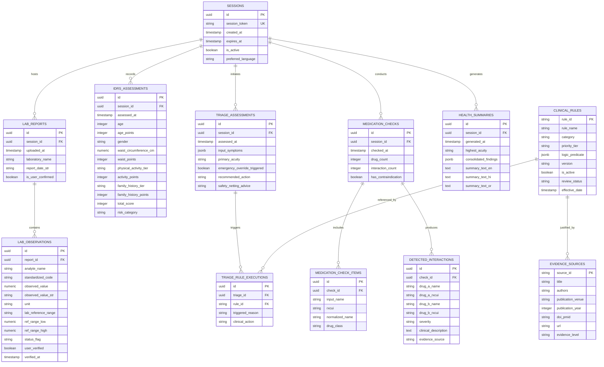

# VYTAL: Relational Database Architecture & Schema Specification

- **Document Version**: 1.0.0
- **Document Status**: Final / Phase 1 Review
- **Engine**: PostgreSQL 16+ (Production / Development), SQLite 3 (Isolated Testing)
- **ORM / Migrations**: SQLAlchemy 2.0 (Declarative Async) / Alembic
- **Design Philosophy**: Privacy-by-Design, Data Minimization, Auditable Clinical Traceability

---

## 1. Data Minimization & Privacy-by-Design Principles

In strict alignment with healthcare privacy standards and ethical data stewardship:
1. **Zero Mandatory Personally Identifiable Information (PII)**:
   - Users are not required to provide their legal name, phone number, government identifier, or exact date of birth to use the platform.
   - All interactions can occur within an anonymous, cryptographically random `Session` token.
2. **Ephemeral Document Processing Policy**:
   - Uploaded laboratory PDF binaries are **never** stored in the database (no `BLOB` or `BYTEA` storage for patient PDFs).
   - PDFs are processed in volatile system memory or ephemeral temporary directories, parsed into discrete text tokens, and immediately unlinked.
   - Only user-confirmed laboratory observations (e.g., Fasting Blood Sugar: 110 mg/dL) are persisted with the user's explicit consent.
3. **Session Expiration & Complete Data Purge**:
   - Sessions have an explicit `expires_at` timestamp (default: 24 hours).
   - An active "Clear My Data" endpoint triggers immediate cascading deletion of all associated observations, scores, triage runs, and medication queries.

---

## 2. Entity-Relationship Diagram (ERD)



---

## 3. Detailed Table Specifications & Schema Definitions

### 3.1 Session & Metadata Entities

#### Table: `sessions`
Represents an anonymous or authenticated user interaction window.
```sql
CREATE TABLE sessions (
    id UUID PRIMARY KEY DEFAULT gen_random_uuid(),
    session_token VARCHAR(64) UNIQUE NOT NULL,
    created_at TIMESTAMP WITH TIME ZONE DEFAULT CURRENT_TIMESTAMP NOT NULL,
    last_accessed_at TIMESTAMP WITH TIME ZONE DEFAULT CURRENT_TIMESTAMP NOT NULL,
    expires_at TIMESTAMP WITH TIME ZONE NOT NULL,
    is_active BOOLEAN DEFAULT TRUE NOT NULL,
    preferred_language VARCHAR(5) DEFAULT 'en' NOT NULL CHECK (preferred_language IN ('en', 'hi', 'or'))
);

CREATE INDEX idx_sessions_token ON sessions(session_token);
CREATE INDEX idx_sessions_expires ON sessions(expires_at) WHERE is_active = TRUE;
```

---

### 3.2 Module 01: Report Explainer Entities

#### Table: `lab_reports`
Holds high-level metadata regarding a parsed laboratory encounter.
```sql
CREATE TABLE lab_reports (
    id UUID PRIMARY KEY DEFAULT gen_random_uuid(),
    session_id UUID NOT NULL REFERENCES sessions(id) ON DELETE CASCADE,
    uploaded_at TIMESTAMP WITH TIME ZONE DEFAULT CURRENT_TIMESTAMP NOT NULL,
    laboratory_name VARCHAR(255) NULL,
    report_date_str VARCHAR(50) NULL,
    parsing_engine VARCHAR(50) DEFAULT 'PyMuPDF-1.24' NOT NULL,
    is_user_confirmed BOOLEAN DEFAULT FALSE NOT NULL
);

CREATE INDEX idx_lab_reports_session ON lab_reports(session_id);
```

#### Table: `lab_observations`
Stores individual laboratory analytes extracted and confirmed by the user.
```sql
CREATE TABLE lab_observations (
    id UUID PRIMARY KEY DEFAULT gen_random_uuid(),
    report_id UUID NOT NULL REFERENCES lab_reports(id) ON DELETE CASCADE,
    analyte_name VARCHAR(150) NOT NULL,
    standardized_code VARCHAR(50) NULL,          -- e.g., LOINC code if mapped
    observed_value NUMERIC(10, 3) NULL,          -- Numeric value for continuous tests
    observed_value_str VARCHAR(100) NOT NULL,    -- Raw extracted string
    unit VARCHAR(50) NULL,                       -- e.g., mg/dL, %, mmol/L
    lab_reference_range VARCHAR(100) NULL,       -- Exactly as printed on the user's PDF
    ref_range_low NUMERIC(10, 3) NULL,           -- Parsed lower boundary if available
    ref_range_high NUMERIC(10, 3) NULL,          -- Parsed upper boundary if available
    status_flag VARCHAR(20) DEFAULT 'NORMAL' NOT NULL CHECK (status_flag IN ('LOW', 'NORMAL', 'HIGH', 'BORDERLINE', 'INDETERMINATE')),
    user_verified BOOLEAN DEFAULT FALSE NOT NULL,
    verified_at TIMESTAMP WITH TIME ZONE NULL
);

CREATE INDEX idx_lab_obs_report ON lab_observations(report_id);
CREATE INDEX idx_lab_obs_analyte ON lab_observations(analyte_name);
```

---

### 3.3 Module 02: Indian Diabetes Risk Score (IDRS) Entities

#### Table: `idrs_assessments`
Records the 4 verified parameters and calculated point tiers per Mohan et al. (2005).
```sql
CREATE TABLE idrs_assessments (
    id UUID PRIMARY KEY DEFAULT gen_random_uuid(),
    session_id UUID NOT NULL REFERENCES sessions(id) ON DELETE CASCADE,
    assessed_at TIMESTAMP WITH TIME ZONE DEFAULT CURRENT_TIMESTAMP NOT NULL,
    
    -- Parameter 1: Age
    age INTEGER NOT NULL CHECK (age >= 1 AND age <= 120),
    age_points INTEGER NOT NULL CHECK (age_points IN (0, 20, 30)),
    
    -- Parameter 2: Abdominal Obesity
    gender VARCHAR(10) NOT NULL CHECK (gender IN ('male', 'female')),
    waist_circumference_cm NUMERIC(5, 1) NOT NULL CHECK (waist_circumference_cm > 30.0 AND waist_circumference_cm < 250.0),
    waist_points INTEGER NOT NULL CHECK (waist_points IN (0, 10, 20)),
    
    -- Parameter 3: Physical Activity
    physical_activity_tier VARCHAR(50) NOT NULL CHECK (physical_activity_tier IN ('vigorous', 'moderate', 'sedentary')),
    activity_points INTEGER NOT NULL CHECK (activity_points IN (0, 20, 30)),
    
    -- Parameter 4: Family History
    family_history_tier VARCHAR(50) NOT NULL CHECK (family_history_tier IN ('none', 'one_parent', 'both_parents')),
    family_history_points INTEGER NOT NULL CHECK (family_history_points IN (0, 10, 20)),
    
    -- Total Calculated Score & Risk Category
    total_score INTEGER NOT NULL CHECK (total_score >= 0 AND total_score <= 100),
    risk_category VARCHAR(20) NOT NULL CHECK (risk_category IN ('low', 'moderate', 'high')),
    
    -- Citations & Validation Metadata
    validation_reference VARCHAR(100) DEFAULT 'Mohan et al. JAPI 2005; 53:759-763' NOT NULL
);

CREATE INDEX idx_idrs_session ON idrs_assessments(session_id);
```

---

### 3.4 Module 03: Symptom Triage Entities

#### Table: `clinical_rules`
Stores versioned, auditable deterministic clinical decision-support rules.
```sql
CREATE TABLE clinical_rules (
    rule_id VARCHAR(50) PRIMARY KEY,             -- e.g., 'RULE-EMERG-ACS-001'
    rule_name VARCHAR(150) NOT NULL,
    category VARCHAR(50) NOT NULL,               -- 'cardiovascular', 'respiratory', 'neurological', etc.
    priority_tier VARCHAR(30) NOT NULL CHECK (priority_tier IN ('EMERGENCY_RED_FLAG', 'HIGH_ACUITY', 'ROUTINE', 'INFORMATIONAL')),
    logic_predicate JSONB NOT NULL,              -- Structured conditions for evaluation
    evidence_source_id VARCHAR(50) NOT NULL,
    version VARCHAR(20) DEFAULT '1.0.0' NOT NULL,
    is_active BOOLEAN DEFAULT TRUE NOT NULL,
    review_status VARCHAR(30) DEFAULT 'APPROVED' NOT NULL,
    effective_date DATE NOT NULL
);

CREATE INDEX idx_clinical_rules_priority ON clinical_rules(priority_tier) WHERE is_active = TRUE;
```

#### Table: `triage_assessments`
Records the user symptom evaluation encounter.
```sql
CREATE TABLE triage_assessments (
    id UUID PRIMARY KEY DEFAULT gen_random_uuid(),
    session_id UUID NOT NULL REFERENCES sessions(id) ON DELETE CASCADE,
    assessed_at TIMESTAMP WITH TIME ZONE DEFAULT CURRENT_TIMESTAMP NOT NULL,
    input_symptoms JSONB NOT NULL,               -- User-reported symptoms, onset, severity
    primary_acuity VARCHAR(30) NOT NULL CHECK (primary_acuity IN ('EMERGENCY', 'URGENT', 'ROUTINE_CLINICAL', 'SELF_CARE')),
    emergency_override_triggered BOOLEAN DEFAULT FALSE NOT NULL,
    recommended_action TEXT NOT NULL,
    safety_netting_advice TEXT NOT NULL
);

CREATE INDEX idx_triage_session ON triage_assessments(session_id);
```

#### Table: `triage_rule_executions`
Audit log linking specific rules that fired during a triage assessment.
```sql
CREATE TABLE triage_rule_executions (
    id UUID PRIMARY KEY DEFAULT gen_random_uuid(),
    triage_id UUID NOT NULL REFERENCES triage_assessments(id) ON DELETE CASCADE,
    rule_id VARCHAR(50) NOT NULL REFERENCES clinical_rules(rule_id),
    triggered_reason TEXT NOT NULL,
    clinical_action TEXT NOT NULL
);

CREATE INDEX idx_rule_exec_triage ON triage_rule_executions(triage_id);
```

---

### 3.5 Module 04: Medication Interaction Checker Entities

#### Table: `medication_checks`
Encapsulates an interaction evaluation run for a cohort of drugs.
```sql
CREATE TABLE medication_checks (
    id UUID PRIMARY KEY DEFAULT gen_random_uuid(),
    session_id UUID NOT NULL REFERENCES sessions(id) ON DELETE CASCADE,
    checked_at TIMESTAMP WITH TIME ZONE DEFAULT CURRENT_TIMESTAMP NOT NULL,
    drug_count INTEGER NOT NULL CHECK (drug_count >= 1),
    interaction_count INTEGER DEFAULT 0 NOT NULL,
    has_contraindication BOOLEAN DEFAULT FALSE NOT NULL
);

CREATE INDEX idx_med_checks_session ON medication_checks(session_id);
```

#### Table: `medication_check_items`
Tracks individual drugs included in the check and their normalized RxCUIs.
```sql
CREATE TABLE medication_check_items (
    id UUID PRIMARY KEY DEFAULT gen_random_uuid(),
    check_id UUID NOT NULL REFERENCES medication_checks(id) ON DELETE CASCADE,
    input_name VARCHAR(150) NOT NULL,
    rxcui VARCHAR(30) NULL,
    normalized_name VARCHAR(150) NULL,
    drug_class VARCHAR(100) NULL,
    normalization_status VARCHAR(30) DEFAULT 'MATCHED' NOT NULL CHECK (normalization_status IN ('MATCHED', 'APPROXIMATE', 'UNMATCHED'))
);

CREATE INDEX idx_med_items_check ON medication_check_items(check_id);
```

#### Table: `detected_interactions`
Stores detected pairwise interactions and their clinical justifications.
```sql
CREATE TABLE detected_interactions (
    id UUID PRIMARY KEY DEFAULT gen_random_uuid(),
    check_id UUID NOT NULL REFERENCES medication_checks(id) ON DELETE CASCADE,
    drug_a_name VARCHAR(150) NOT NULL,
    drug_a_rxcui VARCHAR(30) NULL,
    drug_b_name VARCHAR(150) NOT NULL,
    drug_b_rxcui VARCHAR(30) NULL,
    severity VARCHAR(30) NOT NULL CHECK (severity IN ('CONTRAINDICATED', 'SEVERE', 'MODERATE', 'INFORMATIONAL')),
    clinical_description TEXT NOT NULL,
    evidence_source VARCHAR(255) NOT NULL,
    management_advice TEXT NULL
);

CREATE INDEX idx_detected_interactions_check ON detected_interactions(check_id);
```

---

### 3.6 Module 05: Health Summary Entities

#### Table: `health_summaries`
Stores synthesized briefs combining data from all preceding modules.
```sql
CREATE TABLE health_summaries (
    id UUID PRIMARY KEY DEFAULT gen_random_uuid(),
    session_id UUID NOT NULL REFERENCES sessions(id) ON DELETE CASCADE,
    generated_at TIMESTAMP WITH TIME ZONE DEFAULT CURRENT_TIMESTAMP NOT NULL,
    highest_acuity VARCHAR(30) NOT NULL,
    consolidated_findings JSONB NOT NULL,
    summary_text_en TEXT NOT NULL,
    summary_text_hi TEXT NOT NULL,
    summary_text_or TEXT NOT NULL,
    pdf_download_count INTEGER DEFAULT 0 NOT NULL
);

CREATE INDEX idx_health_summaries_session ON health_summaries(session_id);
```

---

### 3.7 Reference & Evidence Registry Entities

#### Table: `evidence_sources`
Master bibliographic repository for all clinical guidelines, formulas, and interaction sources.
```sql
CREATE TABLE evidence_sources (
    source_id VARCHAR(50) PRIMARY KEY,
    title TEXT NOT NULL,
    authors TEXT NOT NULL,
    publication_venue VARCHAR(255) NOT NULL,
    publication_year INTEGER NOT NULL,
    doi_pmid VARCHAR(100) NULL,
    url TEXT NULL,
    evidence_level VARCHAR(50) NOT NULL,          -- e.g., 'Randomized Controlled Trial', 'Clinical Practice Guideline', 'Epidemiological Cohort'
    last_verified_at DATE NOT NULL
);
```

---

## 4. Database Migrations & Version Control
- All schema changes must be authored as versioned Alembic migration scripts in `backend/alembic/versions/`.
- No direct manual alterations (`ALTER TABLE`) are permitted outside of tracked Alembic migrations.
- Continuous Integration tests run migrations from scratch (`alembic upgrade head`) against an isolated test database to verify reversibility and schema parity.
