# VYTAL: Phased Engineering Implementation Roadmap

- **Document Version**: 1.0.0
- **Document Date**: 2026-11-21
- **Status**: Ready for Human Approval / Execution Blueprint
- **Scope**: Step-by-step technical progression from Phase 2 through Phase 8.

---

## 1. Roadmap Overview & Phasing Architecture

To guarantee architectural stability, clinical safety, and empirical rigor, VYTAL executes across eight controlled, sequential phases:

```mermaid
flowchart LR
    P1["Phase 1: Research & Architecture (COMPLETED)"]
    --> P2["Phase 2: Foundations & Core Scaffolding"]
    --> P3["Phase 3: Module 01 (Report) & Module 02 (IDRS)"]
    --> P4["Phase 4: Module 03 (Triage) & Module 04 (Medication)"]
    --> P5["Phase 5: Module 05 (Summary & Integration)"]
    --> P6["Phase 6: Independent ML Research Pipeline"]
    --> P7["Phase 7: Multilingual, Security & Testing"]
    --> P8["Phase 8: Evaluation & Publication Readiness"]
```

---

## 2. Detailed Phase Specifications

### PHASE 2: Foundations & Core Scaffolding
- **Objective**: Establish the React TypeScript SPA, FastAPI modular backend, PostgreSQL schema migrations, and common UI design tokens.
- **Milestones**:
  - M2.1: Scaffolding frontend with Vite, React 19, TypeScript, Tailwind CSS, React Router v7, Lucide React, and TanStack Query.
  - M2.2: Scaffolding backend with FastAPI, Pydantic v2, CORS, settings management, and logging.
  - M2.3: Database configuration with SQLAlchemy 2.0 async engine and Alembic migrations for core tables (`sessions`, `evidence_sources`).
  - M2.4: Core reusable UI components (Button, Input, Card, Modal, Badge, Table, Tooltip, Alert).
  - M2.5: Application shell layout with responsive header, language selector, navigation tabs, and footer disclaimers.
- **Deliverables**:
  - `frontend/`: Complete React scaffolding and Tailwind tokens.
  - `backend/`: FastAPI runner, `/api/v1/health` and session routes, Alembic environment.
- **Acceptance Criteria**:
  - `GET /api/v1/health` returns status `healthy`.
  - Frontend builds with zero TypeScript errors (`tsc --noEmit`).
  - Dark-navy / teal theme renders cleanly across desktop and mobile viewports.
- **Test Commands**:
  - Frontend: `npm run build && npm test`
  - Backend: `pytest backend/tests/test_health.py`

---

### PHASE 3: Module 01 (Report Explainer) & Module 02 (IDRS)
- **Objective**: Implement the laboratory extraction/explanation engine and the validated Indian Diabetes Risk Score calculation.
- **Milestones**:
  - M3.1: Module 01 Backend: PyMuPDF parser service (`services/report_explainer/`), regex token extractors for blood sugar, HbA1c, lipids, renal markers.
  - M3.2: Module 01 Frontend: Drag-and-drop PDF upload card, extraction progress indicator, editable review grid, and plain-language explanation cards.
  - M3.3: Module 02 Backend: Pydantic service implementing Mohan et al. (2005) 4-factor scoring algorithm and risk categorization.
  - M3.4: Module 02 Frontend: Interactive IDRS questionnaire, waist circumference visual guide, dynamic score dial, and risk breakdown summary.
- **Deliverables**:
  - Endpoints: `/api/v1/reports/upload`, `/api/v1/reports/confirm`, `/api/v1/idrs/calculate`.
  - Frontend pages: `/modules/report-explainer`, `/modules/risk-score`.
- **Acceptance Criteria**:
  - PDF extraction parses synthetic lab reports into editable review table without crashing.
  - IDRS unit tests achieve 100% exact match against Mohan et al. reference cases.
  - User cannot proceed past report explainer without confirming extracted values.
- **Test Commands**:
  - `pytest backend/tests/test_report_parser.py backend/tests/test_idrs.py`

---

### PHASE 4: Module 03 (Symptom Triage) & Module 04 (Medication Checker)
- **Objective**: Implement the deterministic rule engine for emergency triage and the evidence-backed medication interaction search.
- **Milestones**:
  - M4.1: Module 03 Backend: Priority-ordered clinical rule engine (`services/symptom_triage/`), implementing rules `RULE-EMERG-ACS-001` through `RULE-ROUT-METAB-008`.
  - M4.2: Module 03 Frontend: Multi-step symptom intake questionnaire, emergency red-flag immediate override modal, and evidence citation drawer.
  - M4.3: Module 04 Backend: RxNorm normalization client, local curated DDI registry search, and openFDA SPL narrative query adapter.
  - M4.4: Module 04 Frontend: Medication autocomplete search bar, active drug list pills, pairwise interaction alert cards, and mandatory negative disclaimers.
- **Deliverables**:
  - Endpoints: `/api/v1/triage/evaluate`, `/api/v1/medications/search`, `/api/v1/medications/check`.
  - Frontend pages: `/modules/symptom-triage`, `/modules/medication-check`.
- **Acceptance Criteria**:
  - Emergency red flag (e.g., chest pain with radiation) triggers immediate emergency short-circuit with 100% sensitivity.
  - Medication pairs with known severe interactions (e.g., Metformin + Contrast) display clear severity badges and clinical descriptions.
  - Non-interacting drug pairs display the mandatory negative disclaimer.
- **Test Commands**:
  - `pytest backend/tests/test_triage_rules.py backend/tests/test_medication_checker.py`

---

### PHASE 5: Module 05 (Health Summary) & Module Integration
- **Objective**: Synthesize verified findings across Modules 01 through 04 and generate downloadable PDF clinical summaries.
- **Milestones**:
  - M5.1: Backend synthesis engine (`services/health_summary/`), compiling lab findings, IDRS scores, triage acuity, and medication checks into prioritized briefs.
  - M5.2: PDF generation service via ReportLab, rendering timestamped, structured bilingual reports with safety disclaimers.
  - M5.3: Module 05 Frontend: Unified health summary dashboard with priority triage badges and "Download PDF Summary" action.
  - M5.4: Cross-module state flow: Seamless data handover across the 5 modules via unified session storage.
- **Deliverables**:
  - Endpoints: `/api/v1/summary/generate`, `/api/v1/summary/export-pdf`.
  - Frontend page: `/modules/health-summary`.
- **Acceptance Criteria**:
  - Generated summary integrates all active module findings into an acuity-ranked card deck.
  - Downloadable PDF compiles accurately with clean typography and complete source citations.
  - "Clear My Data" removes all session traces from the database.
- **Test Commands**:
  - `pytest backend/tests/test_health_summary.py`

---

### PHASE 6: Independent Python/ML Research Pipeline & Analytics Dashboard
- **Objective**: Build the independent machine learning research pipeline, train 4 benchmark algorithms on South Asian cohorts, compute SHAP values, and build the analytics dashboard.
- **Milestones**:
  - M6.1: Data preparation: Ingesting and formatting the Sylhet South Asian diabetes dataset (UCI 529) and CDC BRFSS (UCI 891).
  - M6.2: Model training pipeline: Fitting Logistic Regression, Decision Tree, Random Forest, and SVM with Stratified 5-Fold Cross-Validation.
  - M6.3: Model evaluation & calibration: Generating confusion matrices, ROC curves, PR curves, and Brier score calibration plots.
  - M6.4: Explainability engine: Computing SHAP values (TreeExplainer / KernelExplainer) and rendering summary and waterfall plots.
  - M6.5: Research UI: Building the "Research & Analytics Dashboard" (`/research-dashboard`) with Model Cards and interactive Plotly charts.
- **Deliverables**:
  - Directory: `/ml/` (training scripts, notebooks, pickled models, model cards).
  - Frontend page: `/pages/ResearchDashboard.tsx`.
- **Acceptance Criteria**:
  - Zero data leakage between train and test splits.
  - Random Forest and Logistic Regression achieve cross-validated ROC-AUC $> 0.90$ on the Sylhet benchmark.
  - ML models are completely partitioned from the 5 clinical modules.
- **Test Commands**:
  - `pytest ml/tests/test_ml_pipeline.py`

---

### PHASE 7: Multilingual Refinement, Accessibility & Security Hardening
- **Objective**: Localize the platform across English, Hindi, and Odia, audit WCAG 2.1 AA accessibility, and execute security hardening.
- **Milestones**:
  - M7.1: Comprehensive translation catalogs (`en`, `hi`, `or`) for all five modules and static pages.
  - M7.2: Unicode script validation: Ensuring Devanagari and Odia render cleanly without text truncation or clipping.
  - M7.3: Accessibility audit: Keyboard navigation, screen-reader ARIA landmarks, and color contrast verification ($\ge 4.5:1$).
  - M7.4: Security testing: Magic-byte PDF upload fuzzing, rate-limiting verification, CORS validation, and dependency vulnerability scans (`npm audit`, `pip-audit`).
- **Deliverables**:
  - Translation files in `frontend/src/i18n/`.
  - Security configuration headers in FastAPI middleware.
- **Acceptance Criteria**:
  - Dynamic language switching preserves all form state and confirmed numbers.
  - Zero high/critical vulnerabilities reported in audit tools.
  - Lighthouse Accessibility score $> 95$.
- **Test Commands**:
  - `pytest backend/tests/test_security.py`
  - `npm run test:e2e` (Playwright test suite)

---

### PHASE 8: Research Evaluation, Documentation & Portfolio Presentation
- **Objective**: Synthesize research outcomes, finalize academic papers, assemble developer documentation, and package the project for publication.
- **Milestones**:
  - M8.1: Complete evaluation report documenting Protocol 1 through 6 results.
  - M8.2: Comprehensive technical documentation, architecture diagrams, and API guides.
  - M8.3: Polished landing page, About/Methodology page, Safety/Limitations page, and Privacy page.
  - M8.4: GitHub repository organization with clean git history, release tags, and automated test badges.
- **Deliverables**:
  - `/research/evaluation_results/`
  - Final project documentation and demonstration assets.
- **Acceptance Criteria**:
  - Complete, reproducible codebase that boots cleanly with a single command.
  - All 13 planning and research specifications fully satisfied.
