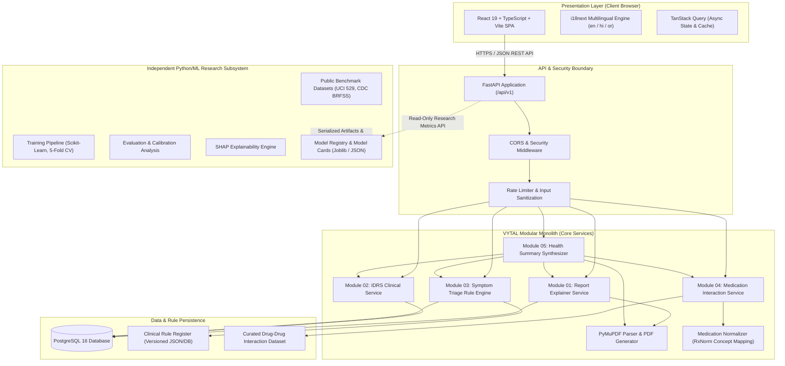
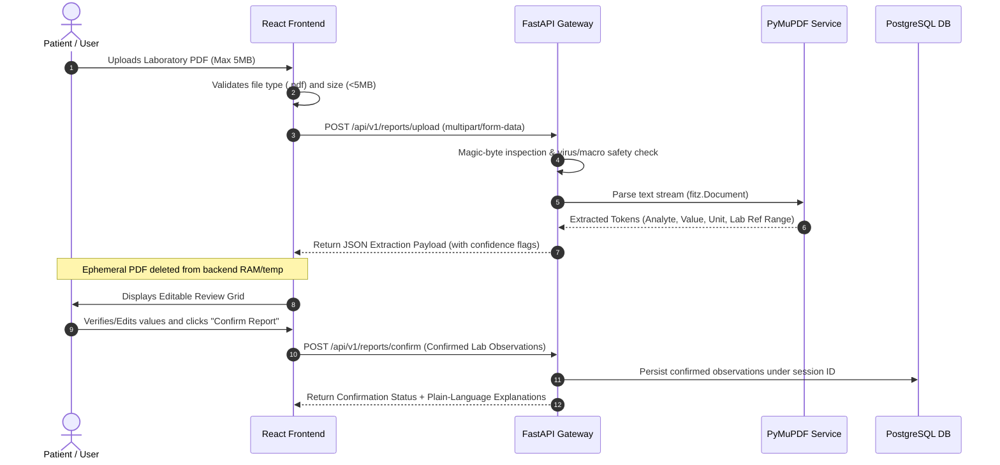
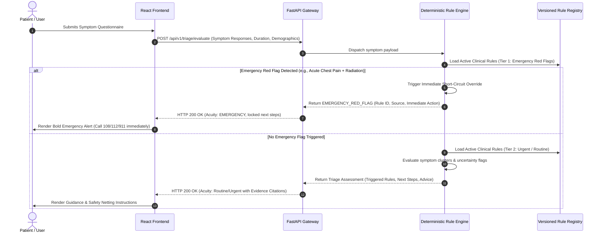

# VYTAL: System Architecture Specification

- **Document Version**: 1.0.0
- **Document Status**: Final / Phase 1 Review
- **Architecture Pattern**: Modular Monolith with Decoupled Research Subsystem
- **Backend**: Python 3.12+ / FastAPI / SQLAlchemy 2.0 / Alembic
- **Frontend**: React 19 / TypeScript / Vite / Tailwind CSS / i18next

---

## 1. High-Level Architectural Overview

VYTAL is structured as a **Modular Monolith** designed for high auditability, clinical safety, performance, and clear research boundaries. Rather than fragmenting the early platform into high-overhead microservices, VYTAL enforces strict boundaries through internal package modularity, shared domain contracts, and a versioned REST API.

The architecture strictly isolates:
1. **The Core Clinical Decision-Support Subsystem**: Deterministic, auditable, and rule-driven services powering the five healthcare modules.
2. **The Machine Learning Research Subsystem**: An independent exploratory data science and model explainability engine that never interferes with clinical rule execution.



---

## 2. Layered Component Boundaries

### 2.1 Presentation Layer (Frontend)
- **Framework**: React 19, TypeScript (strict mode enabled), Vite build engine.
- **Styling**: Tailwind CSS with custom design tokens for healthcare:
  - Clean light surfaces: `#F8FAFC`, `#FFFFFF`
  - Trust teal/green accents: Primary `#0D9488` (Teal 600), Secondary `#059669` (Emerald 600)
  - Deep text contrast: `#0F172A` (Slate 900), `#334155` (Slate 700)
- **State Management**:
  - Module state: TanStack Query (v5) for server cache, synchronization, and optimistic UI.
  - Form & Session state: React Context with local storage fallback for active multi-step workflows.
  - Language state: `i18next` with language change observer maintaining form state.
- **Rule Enforcement**: Frontend **never** performs authoritative clinical scoring, risk calculation, or triage determination. All calculated values and triage states are derived from the backend.

### 2.2 Application & API Layer (Backend)
- **Framework**: FastAPI (asynchronous, OpenAPI 3.1 native, high-throughput).
- **Versioning**: All operational endpoints are prefixed with `/api/v1/`.
- **Validation**: Pydantic v2 schemas for all requests, responses, and internal domain events with strict type coercion and range validation.
- **Error Handling**: Standardized error payloads adhering to RFC 7807 (Problem Details for HTTP APIs).

### 2.3 Domain & Clinical Services Layer
Each of the five modules is encapsulated in a dedicated service package within `backend/app/services/`:
1. `services/report_explainer/`: Handles PyMuPDF text stream extraction, regex and token-based analyte parsing, reference range extraction, and plain-language explanation generation.
2. `services/idrs/`: Executes the 4-factor scoring algorithm, computes exact point values, classifies risk tier, and attaches sensitivity/specificity disclosures.
3. `services/symptom_triage/`: The deterministic triage engine. Evaluates priority-ordered clinical rules, enforces emergency red-flag overrides, tracks rule IDs and evidence sources, and flags missing information.
4. `services/medication_checker/`: Normalizes medication names to RxCUIs, executes pairwise lookups across local curated interaction tables, pulls label extracts from openFDA, and attaches mandatory negative disclaimers.
5. `services/health_summary/`: Integrates confirmed observations, calculates composite priority, coordinates PDF clinical brief generation via ReportLab, and manages session lifecycle.

### 2.4 Data Persistence Layer
- **Relational Database**: PostgreSQL 16 managed via SQLAlchemy 2.0 (declarative async models) and Alembic migration scripts.
- **Privacy Architecture**: Ephemeral processing policy. Raw lab PDFs are processed in-memory or in restricted temp storage and unlinked immediately after extraction. Only user-confirmed observations are written to the database.

### 2.5 Independent ML Research Subsystem
- Located in `/ml/` as an autonomous package completely decoupled from production clinical services.
- Models: Logistic Regression, Decision Tree, Random Forest, Support Vector Machine.
- Storage: Pickled model artifacts (`.joblib`), evaluation metrics (`metrics.json`), SHAP values, and Model Cards (`MODEL_CARD.md`).
- Interaction with Core App: The core FastAPI backend only reads pre-computed evaluation metrics and model cards via a read-only research metadata service to populate the "Research & Analytics Dashboard". The ML model **never** receives or processes live clinical triage traffic.

---

## 3. Detailed Data Flow & Sequence Diagrams

### 3.1 Module 01: Report Upload & Confirmation Flow



### 3.2 Module 03: Symptom Triage Execution & Emergency Override Flow



---

## 4. Software Design Patterns Employed

1. **Repository Pattern (`database/repositories/`)**:
   - Decouples business logic from SQLAlchemy queries, simplifying unit testing with in-memory SQLite mocks.
2. **Strategy Pattern (`services/clinical_rules/`)**:
   - Defines a standard `RuleEvaluator` interface. Different rule sets (Cardiovascular, Respiratory, Neurological) implement the evaluator cleanly.
3. **Chain of Responsibility Pattern (`services/symptom_triage/engine.py`)**:
   - Evaluates triage checks in order of clinical priority: Emergency Red Flags $\to$ High Acuity $\to$ Moderate Acuity $\to$ Routine Self-Care. A positive match in Emergency short-circuits subsequent handlers.
4. **Adapter Pattern (`services/medication_checker/adapters/`)**:
   - Normalizes external responses from RxNorm and openFDA into clean internal domain schemas (`MedicationConcept`, `InteractionPair`).

---

## 5. Technology Stack Rationale

| Layer | Chosen Technology | Alternatives Considered | Rationale for Choice |
| :--- | :--- | :--- | :--- |
| **Frontend Framework** | **React 19 + TypeScript** | Next.js, Vue 3, Svelte | Client-rendered SPA fits interactive multi-step clinical workflows; TypeScript guarantees strict contract safety with backend Pydantic models. |
| **Styling** | **Tailwind CSS** | Material UI, AntD, Chakra | Highly customizable, utility-first approach avoids generic "hospital dashboard" styling and produces minimal CSS bundle footprint. |
| **Backend Framework** | **FastAPI** | Django, Flask, Express | Native async performance, automatic OpenAPI 3.1 documentation, first-class Pydantic v2 validation, perfect fit for ML/Python ecosystem. |
| **ORM & Migrations** | **SQLAlchemy 2.0 + Alembic** | Tortoise-ORM, Django ORM | Industry standard in Python for robust relational data modeling, type checking, and reproducible schema migrations. |
| **PDF Extraction** | **PyMuPDF (fitz)** | PyPDF2, pdfminer.six, Tesseract OCR | PyMuPDF is up to 10x faster than pure-Python parsers, accurately extracts spatial bounding boxes and tabular layout without heavy OCR overhead on digital PDFs. |
| **Database** | **PostgreSQL 16** | MySQL, MongoDB | Rich JSONB support for clinical rule audit trails, strict ACID compliance, and robust relational data integrity. |

---

## 6. Directory Structure Mapping

```
vytal/
├── backend/
│   ├── app/
│   │   ├── api/v1/                   # Versioned REST controllers
│   │   │   ├── endpoints/            # Route handlers per module
│   │   │   │   ├── reports.py        # Module 01 endpoints
│   │   │   │   ├── idrs.py           # Module 02 endpoints
│   │   │   │   ├── triage.py         # Module 03 endpoints
│   │   │   │   ├── medications.py    # Module 04 endpoints
│   │   │   │   ├── summary.py        # Module 05 endpoints
│   │   │   │   └── research.py       # ML Research Dashboard endpoints
│   │   │   └── router.py             # Main v1 API router aggregation
│   │   ├── core/                     # Configuration, security, logging
│   │   ├── database/                 # SQLAlchemy session, base models, repositories
│   │   ├── schemas/                  # Pydantic request/response schemas
│   │   ├── services/                 # Core domain business logic
│   │   │   ├── report_explainer/     # PyMuPDF parser & explanation logic
│   │   │   ├── idrs/                 # 4-factor scoring calculation
│   │   │   ├── symptom_triage/       # Priority-ordered clinical rule engine
│   │   │   ├── medication_checker/   # RxNorm adapter & interaction checker
│   │   │   └── health_summary/       # Synthesis engine & PDF generator
│   │   └── main.py                   # FastAPI entrypoint
│   ├── alembic/                      # Database migrations
│   └── tests/                        # Pytest unit & integration test suite
├── frontend/
│   ├── src/
│   │   ├── components/               # Reusable UI primitives (Button, Card, Modal, Table)
│   │   ├── pages/                    # Route pages (Landing, Dashboard, About, Privacy)
│   │   ├── modules/                  # Feature components matching the 5 modules
│   │   │   ├── report-explainer/
│   │   │   ├── risk-score/
│   │   │   ├── symptom-triage/
│   │   │   ├── medication-check/
│   │   │   └── health-summary/
│   │   ├── i18n/                     # Language catalogs (en, hi, or)
│   │   ├── services/                 # Axios / Fetch API client layer
│   │   └── App.tsx                   # React root router
│   └── tests/                        # Vitest & RTL test suites
└── ml/                               # Independent ML research pipeline
    ├── data/                         # Public benchmark datasets (UCI 529, BRFSS)
    ├── notebooks/                    # EDA, training, and explainability notebooks
    ├── preprocessing/                # Leakage-safe feature pipelines
    ├── training/                     # Model fitting and hyperparameter sweeps
    ├── evaluation/                   # Metrics calculation & calibration plots
    ├── explainability/               # SHAP explainers & visualizations
    ├── models/                       # Pickled models (.joblib)
    └── model_cards/                  # Comprehensive Model Cards
```
