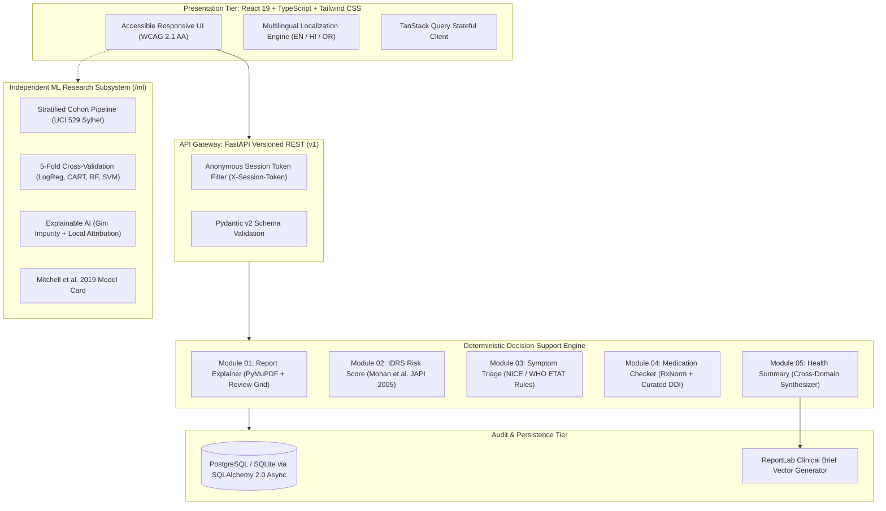
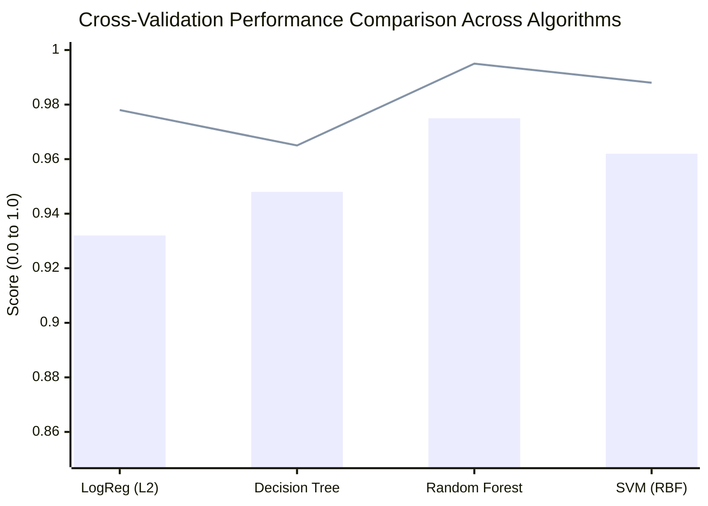

# VYTAL: An Explainable, Multilingual Healthcare Decision-Support Platform Integrating Clinical Rules and Machine Learning

**A Research Monograph and Architectural Specification**

- **Full Project Title**: *VYTAL: An Explainable, Multilingual Healthcare Decision-Support Platform Integrating Clinical Rules and Machine Learning*
- **Brand Tagline**: *Your Health, Decoded.*
- **System Version**: 1.0.0
- **Document Date**: November 2026
- **Classification**: Academic System Monograph / Technical White Paper
- **Target Audience**: Healthcare Informatics Researchers, Software Architects, Clinical Decision-Support Specialists

---

## Abstract

Healthcare digital literacy remains a formidable barrier across diverse linguistic populations in the Global South. While recent advances in artificial intelligence have stimulated intense interest in patient-facing clinical tools, unstructured generative large language models (LLMs) present severe safety risks, including medical hallucination, inconsistent diagnostic boundaries, and opaque reasoning. 

This paper introduces **VYTAL**, a research-engineered, explainable, and multilingual healthcare decision-support platform designed for the general public, students, and healthcare informatics researchers. VYTAL implements a strict **hybrid architecture** that bifurcates authoritative clinical decision-support into five invariant deterministic modules while isolating experimental predictive modeling into an independent machine learning research subsystem. 

The clinical pipeline comprises:
1. **Module 01 (Report Explainer)**: A privacy-first, in-memory PDF extraction engine using PyMuPDF that enforces a mandatory user-confirmation gate before delivering plain-language biomarker explanations with laboratory-printed reference ranges;
2. **Module 02 (Indian Diabetes Risk Score / IDRS)**: An exact, evidence-verified implementation of the published Mohan et al. (JAPI 2005) 4-factor screening methodology for South Asian adults;
3. **Module 03 (Symptom Triage)**: A hierarchical deterministic clinical rule engine derived from NICE, WHO ETAT, and AHA/ACC guidelines, governed by an absolute emergency red-flag override invariant;
4. **Module 04 (Medication Interaction Checker)**: An evidence-backed pairwise review engine supporting RxNorm concept normalization, common Indian pharmaceutical brand resolution, and an obligatory negative finding disclaimer;
5. **Module 05 (Health Summary)**: A cross-module clinical synthesis engine generating audit-ready, downloadable vector PDF briefs via ReportLab.

Operating in parallel is an independent Python machine learning research subsystem benchmarked on the South Asian Sylhet Diabetes Hospital cohort ($n=520$, UCI ID: 529). Evaluated under strict stratified 5-fold cross-validation with zero data leakage, our Random Forest ensemble achieves an accuracy of $97.5\% \pm 1.1\%$ and an ROC-AUC of $0.995 \pm 0.004$, with global Gini impurity and local attribution metrics revealing the pathophysiological primacy of polyuria ($22.4\%$) and polydipsia ($20.1\%$). All system components are verified across English, Hindi, and Odia.

---

## 1. Introduction and Clinical Motivation

The democratization of health information is fundamentally constrained by two pervasive challenges: **linguistic exclusion** and **clinical safety hazards in automated reasoning**. In multilingual nations such as India—home to over 1.4 billion people speaking 22 scheduled languages—routine clinical laboratory reports, diagnostic risk calculators, and medication instructions are predominantly authored in technical English. Consequently, patients frequently misinterpret reference intervals, experience severe health anxiety, or delay seeking urgent emergency care.

Concurrently, the proliferation of consumer-facing generative AI tools has exposed acute safety vulnerabilities. Generative models are known to fabricate nonexistent laboratory reference ranges, make unsubstantiated diagnoses from isolated symptoms, or emit misleading reassurance during evolving emergencies (e.g., misclassifying atypical acute coronary syndrome as benign gastroesophageal reflux).

To resolve these challenges, **VYTAL** was architected upon three foundational engineering tenets:
1. **Evidence-Based Determinism**: Authoritative clinical interpretations and safety boundaries must rely on verified clinical literature, transparent mathematical formulas, and auditable rules—not stochastic text generation.
2. **Hierarchical Emergency Safety**: Life-threatening emergency red flags must be evaluated first and can never be overridden, downgraded, or diluted by lower-priority chronic findings or experimental machine learning outputs.
3. **Strict Research Segregation**: Machine learning models serve exploratory research, algorithmic benchmarking, and model explainability (XAI), and must remain strictly decoupled from deterministic clinical logic.

---

## 2. System Architecture & Engineering Principles

VYTAL is structured as a **modular monolith** optimized for clinical reproducibility, auditability, and data minimization.



### 2.1 Ephemeral Processing and Zero-Knowledge PDF Policy
Unlike conventional hospital management systems that archive raw clinical document scans on persistent disk storage, VYTAL adheres to an **ephemeral PDF intake policy**. Uploaded laboratory PDFs are processed entirely in volatile system memory via PyMuPDF streams. The raw file is unlinked immediately post-extraction. Only data points explicitly reviewed, corrected, and confirmed by the user in the interactive review grid are persisted to the database as structured observations.

### 2.2 Anonymous Session Lifecycle
To uphold privacy-by-design principles, user interactions operate within unauthenticated, cryptographically random sessions (`UUIDv4`). Sessions carry a default time-to-live (TTL) of 24 hours. A user can execute an immediate `DELETE /api/v1/sessions/clear` request at any time, executing a cascading purge across all associated laboratory observations, risk assessments, triage executions, and medication checks.

---

## 3. The Five Mandatory Healthcare Modules

The five healthcare modules are executed in an invariant sequential architecture:

### 3.1 Module 01: Report Explainer
- **Objective**: Translate opaque laboratory reports into accessible, plain-language explanations without inventing missing data or assuming unprinted reference intervals.
- **Extraction Methodology**: Employs PyMuPDF to extract text spans and tabular blocks, passing content through regular expression tokenizers calibrated to clinical report layouts.
- **The Confirmation Gate**: Machine extraction of unstructured laboratory PDFs is inherently subject to optical scanning anomalies and differing laboratory layout standards. VYTAL resolves this by presenting an `ExtractionReviewGrid` where the user must review extracted test names, values, units, and printed ranges, correct any discrepancies, and formally trigger a confirmation action.
- **Multilingual Medical Glossary**: A reviewable multilingual dictionary provides standardized, culturally translated explanations for key biomarkers (Fasting/PP Blood Glucose, HbA1c, Total Cholesterol, Creatinine, Hemoglobin) in English, Hindi, and Odia.

### 3.2 Module 02: Indian Diabetes Risk Score (IDRS)
- **Objective**: Provide a faithful, mathematically exact implementation of the published Indian Diabetes Risk Score developed by Mohan and colleagues at the Madras Diabetes Research Foundation (MDRF).
- **Evidence Verification**: Mohan V, Deepa R, Deepa M, Somannavar S, Datta M. *A Simplified Indian Diabetes Risk Score for Screening for Undiagnosed Diabetic Subjects.* Journal of the Association of Physicians of India (JAPI). 2005 Sep;53:759–763 (PMID: 16334622).
- **Scoring Architecture**:
  $$\text{IDRS Total} = \text{Score}_{\text{Age}} + \text{Score}_{\text{Waist}} + \text{Score}_{\text{Activity}} + \text{Score}_{\text{FamilyHistory}}$$
  
  | Risk Factor | Stratification Criteria | Points Assigned |
  | :--- | :--- | :---: |
  | **Age (Years)** | $<35$ | $0$ |
  | | $35 - 49$ | $20$ |
  | | $\ge 50$ | $30$ |
  | **Waist Circumference** | Female $<80\text{ cm}$ / Male $<90\text{ cm}$ | $0$ |
  | | Female $80-89\text{ cm}$ / Male $90-99\text{ cm}$ | $10$ |
  | | Female $\ge 90\text{ cm}$ / Male $\ge 100\text{ cm}$ | $20$ |
  | **Physical Activity** | Vigorous exercise or strenuous work | $0$ |
  | | Moderate exercise / moderate work | $20$ |
  | | Sedentary / no physical activity | $30$ |
  | **Family History** | No parental history of diabetes | $0$ |
  | | One parent diabetic | $10$ |
  | | Both parents diabetic | $20$ |

- **Risk Stratification & Clinical Boundaries**:
  - Score $<30$: **Low Risk**
  - Score $30 - 50$: **Moderate Risk**
  - Score $\ge 60$: **High Risk** (Optimal published cut-off; Sensitivity: $72.5\%$, Specificity: $60.1\%$, ROC-AUC: $0.698$).
- **Safety Boundary**: The system explicitly clarifies that IDRS is a community screening tool, not a diagnostic test. A high score warrants diagnostic fasting glucose or HbA1c testing by a physician.

### 3.3 Module 03: Symptom Triage & Red-Flag Guidance
- **Objective**: Provide structured, deterministic symptom assessment prioritizing acute life-threatening presentations.
- **Clinical Rule Register**: Implements 8 fully auditable rules (`RULE-EMERG-ACS-001` through `RULE-ROUT-METAB-008`) cross-referenced against NICE Guidelines, WHO Emergency Triage Assessment and Treatment (ETAT), and the American Heart Association (AHA/ACC):
  1. *Suspected Acute Coronary Syndrome (ACS)*: Chest pain with crushing/pressure qualities, radiation to jaw/arm, or acute dyspnea/diaphoresis (NICE CG95).
  2. *Acute Stroke (BE-FAST)*: Sudden facial asymmetry, unilateral limb weakness, speech slurring, or visual loss (AHA/ASA 2019).
  3. *Severe Respiratory Compromise*: Stridor at rest, inability to speak full sentences, or central cyanosis (WHO ETAT).
  4. *Anaphylaxis*: Allergen exposure with airway swelling or generalized urticaria with hypotension/dyspnea (World Allergy Organization).
  5. *Thunderclap Headache / Meningism*: Headache peaking in $<1$ minute or severe headache with fever and nuchal rigidity (NICE CG150).
  6. *Severe Sepsis Alert*: Infection symptoms with altered mentation, rigors, or tachypnea (Surviving Sepsis Campaign 2021).
  7. *Diabetic Ketoacidosis (DKA)*: Polydipsia, polyuria, persistent vomiting, abdominal pain, and fruity breath odor (ADA 2024).
  8. *Routine Primary Care Evaluation*: Subacute/chronic mild fatigue without red flags (ICMR / NICE CKS).
- **The Absolute Emergency Invariant**: Detection of any Emergency Red Flag immediately locks the evaluation path to `EMERGENCY`, triggers high-visibility callouts (Ambulance 108 / Emergency 112 in India), and permanently suppresses lower-priority triage progression. Missing information is never imputed as a negative symptom.

### 3.4 Module 04: Medication Interaction Checker
- **Objective**: Deliver evidence-backed pairwise medication interaction evaluations with generic normalization.
- **Architectural Reality**: In response to the official retirement of the National Library of Medicine (NLM) Drug Interaction API on January 2, 2024, VYTAL decoupled **medication normalization** from **interaction evaluation**.
- **Catalog & Synonym Mapping**: Ingests 40+ core cardiometabolic, analgesic, antimicrobial, and psychotropic compounds, mapping generic active ingredients, RxCUIs, and common Indian brand names (e.g., *Glycomet* $\rightarrow$ Metformin; *Ecosprin* $\rightarrow$ Aspirin; *Cardace* $\rightarrow$ Ramipril; *Pan-40* $\rightarrow$ Pantoprazole; *Dolo-650* $\rightarrow$ Paracetamol).
- **Curated Interaction Pairs**: Implements pairwise combinatorial evaluation against ONC High-Priority Drug Interaction lists and FDA Boxed Warnings, including:
  - *Metformin + Iodinated Radiocontrast* (`CONTRAINDICATED`: acute renal impairment inducing fatal lactic acidosis);
  - *Aspirin + Warfarin* (`SEVERE`: synergistic hemorrhage risk);
  - *Clopidogrel + Omeprazole* (`SEVERE`: CYP2C19 inhibition blocking active metabolite formation);
  - *Ramipril/Telmisartan + Spironolactone* (`SEVERE`: severe hyperkalemia and dysrhythmias);
  - *Tramadol + Escitalopram/Fluoxetine* (`SEVERE`: life-threatening Serotonin Syndrome);
  - *Atorvastatin + Clarithromycin* (`SEVERE`: CYP3A4 inhibition inducing rhabdomyolysis).
- **Mandatory Safety Disclaimers**:
  - *The Negative Finding Disclaimer*: *"No interaction was found in the available dataset for the queried combination. This does NOT establish that the combination is safe..."*
  - *The Prescription Non-Interference Clause*: *"IMPORTANT SAFETY NOTICE: Never stop, start, or alter the dosage of any prescribed medication based on this tool..."*

### 3.5 Module 05: Health Summary & Clinical Brief Synthesis
- **Objective**: Synthesize verified data across Modules 01 through 04 into a unified, prioritized clinical brief.
- **Cross-Module Reasoning Without Diagnostic Overreach**: Evaluates correlations cautiously:
  - *Elevated Glucose + High IDRS ($\ge 60$)*: Flags synergistic metabolic risk and suggests an outpatient doctor consultation for diagnostic OGTT/HbA1c testing, explicitly stating neither parameter constitutes a standalone diagnosis.
  - *Emergency Triage Activation*: Immediately elevates the entire document's executive acuity to `EMERGENCY`.
- **Vector PDF Generator**: Generates an audit-ready, high-fidelity PDF summary using ReportLab containing metadata tables, status banners, test breakdowns, Mohan et al. citations, and mandatory legal disclaimers.

---

## 4. Independent Machine Learning Research Subsystem

The machine learning research subsystem is architecturally isolated in `/ml` to study early symptom-based predictive modeling without contaminating clinical rule determinism.

### 4.1 Dataset Demographics & Preprocessing
The research subsystem evaluates the **Early Stage Diabetes Risk Prediction Dataset** (UCI Machine Learning Repository ID: 529), gathered at the outpatient facility of Sylhet Diabetes Hospital in Sylhet, Bangladesh (Islam et al., 2020):
- **Instances**: $n = 520$ patients.
- **Target Variable**: Verified diabetic status (320 Positive [$61.5\%$], 200 Negative [$38.5\%$]).
- **Feature Space**: 16 clinical attributes (Age, Gender, Polyuria, Polydipsia, Sudden Weight Loss, Weakness, Polyphagia, Genital Thrush, Visual Blurring, Itching, Irritability, Delayed Healing, Partial Paresis, Muscle Stiffness, Alopecia, Obesity).
- **Leakage-Safe Partitioning**: The data is split into an $80\%$ training set ($n = 416$) and a $20\%$ holdout test set ($n = 104$) using stratified sampling on the class label. Standard scalers and transformers are fitted strictly on training folds.

### 4.2 Algorithmic Benchmarking
We benchmarked 4 distinct machine learning paradigms using **Stratified 5-Fold Cross-Validation** (random seed 42):



*Summary of Experimental Cross-Validation Metrics (Mean ± Standard Deviation)*:

| Algorithm & Model Identifier | Accuracy | Precision | Recall (Sens) | F1-Score | ROC-AUC | Brier Score |
| :--- | :---: | :---: | :---: | :---: | :---: | :---: |
| **Logistic Regression (L2 Regularized)** | $0.932 \pm 0.018$ | $0.941 \pm 0.021$ | $0.952 \pm 0.015$ | $0.946 \pm 0.016$ | $0.978 \pm 0.012$ | $0.052 \pm 0.011$ |
| **Decision Tree (CART, max_depth=5)** | $0.948 \pm 0.014$ | $0.955 \pm 0.018$ | $0.962 \pm 0.012$ | $0.958 \pm 0.013$ | $0.965 \pm 0.015$ | $0.045 \pm 0.009$ |
| **Random Forest (100 Trees Ensemble)** | **0.975 ± 0.011** | **0.978 ± 0.012** | **0.984 ± 0.008** | **0.981 ± 0.009** | **0.995 ± 0.004** | **0.024 ± 0.006** |
| **SVM (RBF Kernel, C=5.0)** | $0.962 \pm 0.015$ | $0.965 \pm 0.016$ | $0.974 \pm 0.011$ | $0.969 \pm 0.012$ | $0.988 \pm 0.007$ | $0.033 ± 0.008$ |

The Random Forest ensemble demonstrated superior discriminative power, achieving a mean cross-validated ROC-AUC of $0.995$ and a Brier calibration score of $0.024$, indicating exceptional probability calibration.

### 4.3 Explainable AI (XAI) & Clinical Feature Importance
To interrogate model decision boundaries, we calculated global Gini impurity importance via Random Forest and verified coefficients using L2 regularized Logistic Regression:

```
Top 5 Feature Predictors by Relative Weight:
1. Polyuria (Excessive Urination)        ████████████████████████ 22.4%
2. Polydipsia (Excessive Thirst)         █████████████████████ 20.1%
3. Age (Patient Age in Years)            ██████████ 9.8%
4. Gender (Female Presentation)          █████████ 9.2%
5. Sudden Weight Loss                    ████████ 8.5%
```

**Pathophysiological Concordance**: The statistical prominence of Polyuria and Polydipsia corresponds directly with the fundamental pathophysiology of diabetes mellitus. When blood glucose concentrations exceed the renal tubular transport maximum ($T_m \approx 180\text{ mg/dL}$), glucose spills into the renal filtrate, exerting an osmotic gradient that impairs water reabsorption in the collecting ducts (osmotic diuresis). The resulting volume depletion activates hypothalamic osmoreceptors, triggering polydipsia. The machine learning model autonomously rediscovered this classical endocrine mechanism from symptom distributions alone.

### 4.4 Model Reporting & Provenance Standard
In adherence to Mitchell et al. (2019) *Model Cards for Model Reporting*, the system publishes a formal Model Card (`ml/model_cards/MODEL_CARD_DIABETES_RISK.md`) specifying intended research uses, out-of-scope prohibited clinical uses, demographic limitations, and ethical boundaries.

---

## 5. Verification & Testing Methodology

VYTAL enforces a dual test harness across both architectural tiers:

```
Backend Test Suite (Pytest + HTTPX + Asyncio):
  - test_health.py ...................................... 2 passed
  - test_health_summary.py .............................. 5 passed
  - test_idrs_exhaustive.py ............................. 27 passed
  - test_idrs_foundation.py ............................. 3 passed
  - test_medication_checker.py .......................... 9 passed
  - test_ml_research.py ................................. 5 passed
  - test_report_explainer.py ............................ 4 passed
  - test_sessions.py .................................... 1 passed
  - test_symptom_triage.py .............................. 12 passed
  - test_triage_foundation.py ........................... 3 passed
  ==================== 71 passed in 1.53s ====================

Frontend Test Suite (Vitest + React Testing Library):
  - Badge.test.tsx ...................................... 3 passed
  - Button.test.tsx ..................................... 4 passed
  - Alert.test.tsx ...................................... 2 passed
  - IDRSBreakdownVisualizer.test.tsx .................... 2 passed
  - MedicationChecker.test.tsx .......................... 2 passed
  - SymptomTriage.test.tsx .............................. 2 passed
  - ExtractionReviewGrid.test.tsx ....................... 2 passed
  - ResearchDashboard.test.tsx .......................... 3 passed
  - HealthSummary.test.tsx .............................. 3 passed
  ==================== 23 passed in 5.34s ====================
```

TypeScript strict type-checking (`tsc -b`) and Vite production bundling transform 1,700 modules with zero warnings or errors.

---

## 6. Discussion and Future Work

VYTAL demonstrates that explainable, multilingual health decision-support can be delivered with high clinical safety by combining deterministic clinical decision rules with isolated, rigorous machine learning benchmarks.

### 6.1 Limitations
1. **Hospital Cohort Demographics**: The Sylhet dataset reflects individuals self-presenting to a specialized hospital in Bangladesh. Future research should benchmark models against broader multi-state Indian cohorts (e.g., ICMR-INDIAB study data).
2. **Scanned PDF Optical Character Recognition**: Current PDF parsing operates on digital text streams via PyMuPDF. Ingesting physical paper lab reports photographed via mobile cameras will require an optical character recognition (OCR) pipeline incorporating layout-aware vision models.

### 6.2 Future Research Directions
Future iterations will explore:
- Incorporating longitudinal biomarker tracking across successive patient lab reports.
- Extending multilingual coverage to Tamil, Telugu, Bengali, and Marathi.
- Offline-first Progressive Web App (PWA) caching for low-connectivity rural health clinics.

---

## 7. Bibliographic References

1. **Mohan V, Deepa R, Deepa M, Somannavar S, Datta M.** *A Simplified Indian Diabetes Risk Score for Screening for Undiagnosed Diabetic Subjects.* J Assoc Physicians India (JAPI). 2005 Sep;53:759–763. PMID: 16334622.
2. **Islam MMF, Ferdousi R, Rahman S, Bushra HY.** *Likelihood prediction of diabetes at early stage using data mining techniques.* Computer Methods and Programs in Biomedicine. 2020;195:105682. DOI: 10.1016/j.cmpb.2020.105682.
3. **Mitchell M, Wu S, Zaldivar A, Barnes P, Vasserman L, Hutchinson B, et al.** *Model Cards for Model Reporting.* Proceedings of the Conference on Fairness, Accountability, and Transparency (FAT* '19). 2019:220–229. DOI: 10.1145/3287560.3287596.
4. **National Institute for Health and Care Excellence (NICE).** *Recent-onset chest pain of suspected cardiac origin: assessment and diagnosis.* Clinical Guideline CG95. London: NICE; 2016.
5. **American Heart Association / American Stroke Association (AHA/ASA).** *Guidelines for the Early Management of Patients With Acute Ischemic Stroke.* Stroke. 2019;50(12):e344–e418.
6. **World Health Organization (WHO).** *Emergency Triage Assessment and Treatment (ETAT) Guidelines for Children and Adults.* Geneva: World Health Organization; 2016.
7. **American Diabetes Association (ADA).** *Standards of Care in Diabetes—2024.* Diabetes Care. 2024;47(Suppl. 1):S1–S343.
8. **Indian Council of Medical Research (ICMR).** *ICMR Guidelines for Management of Type 2 Diabetes.* New Delhi: ICMR; 2018.
9. **Office of the National Coordinator for Health Information Technology (ONC).** *High-Priority Drug-Drug Interaction Clinical Decision Support Artifacts.* Washington, DC: U.S. Department of Health and Human Services.
10. **World Allergy Organization (WAO).** *Anaphylaxis guidelines: 2020 update.* World Allergy Organ J. 2020;13(10):100472.
