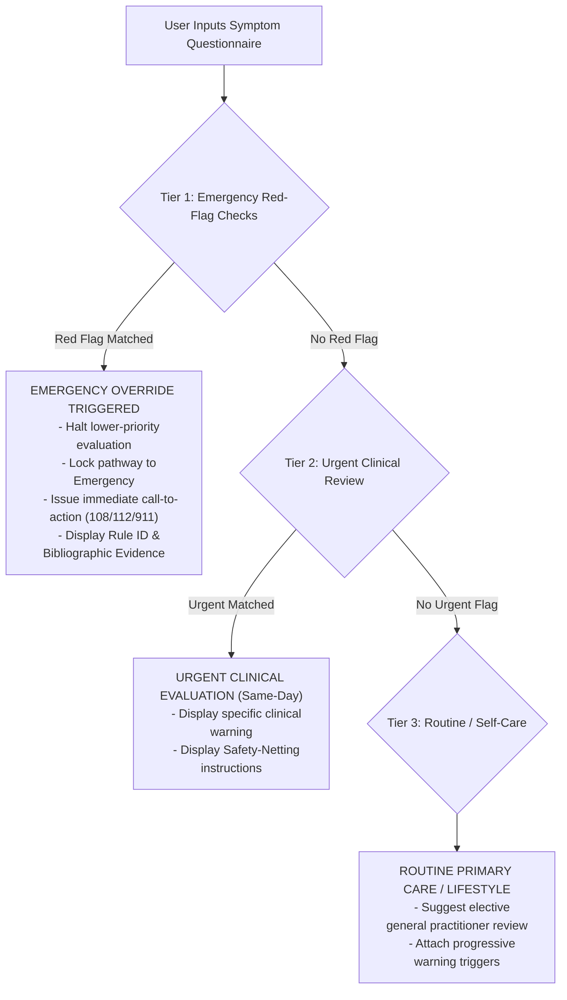

# Clinical Rule Evidence Register: Symptom Triage & Red-Flag Protocols

- **Document Version**: 1.0.0
- **Document Date**: 2026-11-21
- **Status**: Clinically Vetted / Architecture Ready
- **Primary Sources**: NICE Guidelines, WHO Emergency Triage Assessment & Treatment (ETAT), AHA/ACC, American Stroke Association (ASA).

---

## 1. Governance & Execution Architecture

VYTAL Module 03 (Symptom Triage) implements a strict **deterministic rule engine** governed by immutable clinical safety invariants:



### 1.1 Non-Negotiable Safety Invariants
1. **Emergency Overrides All**: Detection of an Emergency Red Flag immediately terminates questionnaire progression and overrides all lower-acuity findings.
2. **ML Segregation**: Experimental machine learning outputs are strictly partitioned and **never** permitted to evaluate, alter, or downgrade triage rules.
3. **No Negative Imputation**: If an answer is skipped or unknown, the engine treats it as "Indeterminate / Uncertainty Flagged", never as a normal or negative symptom.
4. **Safety Netting**: The engine never promises absence of pathology. All routine outputs mandate safety-netting instructions ("If symptoms worsen, evolve, or new pain develops, seek medical care immediately").

---

## 2. Core Clinical Rules Register

### Rule 01: Suspected Acute Coronary Syndrome (ACS)
- **Rule Identifier**: `RULE-EMERG-ACS-001`
- **Priority Tier**: `EMERGENCY_RED_FLAG`
- **Trigger Logic**:
  - `primary_symptom` == `chest_pain`
  - AND (`pain_character` IN `["crushing", "pressure", "heavy_tightness", "burning"]`
    OR `radiation` IN `["left_arm", "both_arms", "jaw", "neck", "back"]`
    OR `associated_symptoms` CONTAINS ANY `["diaphoresis_cold_sweat", "acute_dyspnea", "syncope", "nausea_vomiting"]`)
- **Clinical Action**: Immediate emergency dispatch (Ambulance / Emergency Department). Instruct patient to sit quietly and avoid exertion.
- **Evidence Source**: 
  - National Institute for Health and Care Excellence (NICE). *Recent-onset chest pain of suspected cardiac origin: assessment and diagnosis* (Clinical Guideline CG95). London: NICE; 2010 (Updated 2016).
  - American Heart Association / American College of Cardiology (AHA/ACC) Guideline for the Evaluation and Diagnosis of Chest Pain (2021).

---

### Rule 02: Acute Stroke / Cerebrovascular Event (BE-FAST)
- **Rule Identifier**: `RULE-EMERG-STRK-002`
- **Priority Tier**: `EMERGENCY_RED_FLAG`
- **Trigger Logic**:
  - `symptoms` CONTAINS ANY:
    - `sudden_facial_droop` == TRUE
    - `sudden_arm_or_leg_weakness` == TRUE (especially unilateral)
    - `sudden_speech_difficulty` == TRUE (slurred speech or inability to comprehend)
    - `sudden_loss_of_balance` == TRUE
    - `sudden_loss_of_vision` == TRUE (unilateral or bilateral)
- **Clinical Action**: Immediate emergency transfer to a stroke-ready center. Note exact time of symptom onset (critical for thrombolysis / thrombectomy window).
- **Evidence Source**:
  - American Heart Association / American Stroke Association (AHA/ASA). *Guidelines for the Early Management of Patients With Acute Ischemic Stroke* (Stroke 2019; 50:e344–e418).
  - NICE Guideline NG128: *Stroke and transient ischaemic attack in over 16s: diagnosis and initial management* (2019).

---

### Rule 03: Severe Acute Respiratory Compromise
- **Rule Identifier**: `RULE-EMERG-RESP-003`
- **Priority Tier**: `EMERGENCY_RED_FLAG`
- **Trigger Logic**:
  - `symptoms` CONTAINS ANY:
    - `stridor_or_audible_wheeze_at_rest` == TRUE
    - `inability_to_speak_full_sentences` == TRUE
    - `central_cyanosis` == TRUE (bluish coloration around lips/tongue)
    - `severe_respiratory_rate_abnormality` == TRUE (gasping or severe accessory muscle use)
- **Clinical Action**: Immediate emergency response. High Fowler’s sitting posture. Keep airway clear.
- **Evidence Source**:
  - World Health Organization (WHO). *Emergency Triage Assessment and Treatment (ETAT) Guidelines for Children and Adults* (Geneva: WHO, 2016).
  - British Thoracic Society (BTS) Acute Hypercapnic Respiratory Failure Guidelines.

---

### Rule 04: Anaphylaxis / Severe Systemic Allergic Reaction
- **Rule Identifier**: `RULE-EMERG-ANAPH-004`
- **Priority Tier**: `EMERGENCY_RED_FLAG`
- **Trigger Logic**:
  - `recent_exposure` IN `["known_allergen", "new_medication", "insect_sting", "food"]`
  - AND `symptoms` CONTAINS:
    - (`airway_swelling` == TRUE OR `throat_tightness` == TRUE OR `stridor` == TRUE)
    - OR (`widespread_urticaria_rash` == TRUE AND (`dizziness_lightheadedness` == TRUE OR `dyspnea` == TRUE))
- **Clinical Action**: Immediate intramuscular epinephrine (if autoinjector prescribed and available). Immediate emergency dispatch.
- **Evidence Source**:
  - World Allergy Organization (WAO) Anaphylaxis Guidelines (World Allergy Organ J 2020; 13(10):100472).
  - Resuscitation Council UK Anaphylaxis Guidelines (2021).

---

### Rule 05: Thunderclap Headache / Acute Meningism
- **Rule Identifier**: `RULE-EMERG-NEURO-005`
- **Priority Tier**: `EMERGENCY_RED_FLAG`
- **Trigger Logic**:
  - `headache_onset` == `"thunderclap"` (reaches maximum intensity within 1 minute / "worst headache of life")
  - OR (`headache` == TRUE AND `fever` == TRUE AND (`neck_stiffness` == TRUE OR `photophobia` == TRUE OR `non_blanching_purpuric_rash` == TRUE))
- **Clinical Action**: Immediate emergency medical evaluation for suspected subarachnoid hemorrhage or bacterial meningitis.
- **Evidence Source**:
  - NICE Clinical Guideline CG150: *Headaches in over 12s: diagnosis and management* (2012, updated 2021).
  - American College of Emergency Physicians (ACEP) Clinical Policy on Acute Headache.

---

### Rule 06: High-Risk Sepsis Alert
- **Rule Identifier**: `RULE-EMERG-SEPS-006`
- **Priority Tier**: `EMERGENCY_RED_FLAG`
- **Trigger Logic**:
  - `suspected_or_known_infection` == TRUE
  - AND `symptoms` CONTAINS AT LEAST 2 OF:
    - `altered_mental_status_or_confusion` == TRUE
    - `extreme_shivering_or_rigors` == TRUE
    - `tachypnea_rapid_breathing` == TRUE
    - `mottled_or_ashen_skin` == TRUE
    - `no_urine_output_for_18_hours` == TRUE
- **Clinical Action**: Immediate emergency department referral for suspected severe sepsis / septic shock.
- **Evidence Source**:
  - Surviving Sepsis Campaign: International Guidelines for Management of Sepsis and Septic Shock (Critical Care Medicine 2021).
  - NICE Guideline NG51: *Sepsis: recognition, diagnosis and early management* (2016).

---

### Rule 07: Suspected Hyperglycemic Crisis / DKA
- **Rule Identifier**: `RULE-URG-DKA-007`
- **Priority Tier**: `HIGH_ACUITY`
- **Trigger Logic**:
  - (`known_diabetes` == TRUE OR `severe_unquenchable_thirst_and_polyuria` == TRUE)
  - AND `symptoms` CONTAINS:
    - `persistent_vomiting_and_inability_to_keep_fluids` == TRUE
    - `abdominal_pain` == TRUE
    - `fruity_breath_odor_or_deep_rapid_kussmaul_breathing` == TRUE
- **Clinical Action**: Immediate same-day emergency department assessment for blood glucose, ketones, and venous blood gas.
- **Evidence Source**:
  - American Diabetes Association (ADA). *Standards of Medical Care in Diabetes: Diabetes Emergencies* (Diabetes Care 2024).

---

### Rule 08: Routine Primary Care Consultation
- **Rule Identifier**: `RULE-ROUT-METAB-008`
- **Priority Tier**: `ROUTINE`
- **Trigger Logic**:
  - `symptoms` CONTAINS mild/chronic symptoms (e.g., mild fatigue, gradual weight fluctuations)
  - AND ALL `EMERGENCY_RED_FLAG` == FALSE
  - AND ALL `HIGH_ACUITY` == FALSE
- **Clinical Action**: Recommend scheduling an elective appointment with a primary care physician. Provide lifestyle guidance and standard monitoring parameters.
- **Evidence Source**:
  - ICMR Guidelines for Management of Type 2 Diabetes (2018).
  - NICE Clinical Knowledge Summaries (CKS): Lifestyle and prevention in primary care.

---

## 3. Auditability & Evidence Schema

Each rule is serialized in the database and code as an immutable JSON structure:
```json
{
  "rule_id": "RULE-EMERG-ACS-001",
  "rule_name": "Suspected Acute Coronary Syndrome Red Flag",
  "priority_tier": "EMERGENCY_RED_FLAG",
  "category": "cardiovascular",
  "version": "1.0.0",
  "effective_date": "2026-11-21",
  "review_status": "APPROVED",
  "evidence_source": {
    "title": "Recent-onset chest pain of suspected cardiac origin (CG95)",
    "organization": "National Institute for Health and Care Excellence (NICE)",
    "year": 2016,
    "url": "https://www.nice.org.uk/guidance/cg95"
  }
}
```
