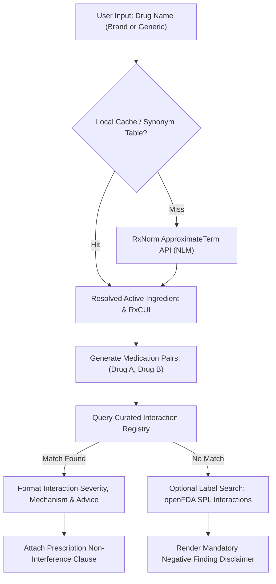

# Medication Interaction Data Sources & Normalization Strategy Review

- **Document Version**: 1.0.0
- **Review Date**: 2026-11-21
- **Status**: Verified / Architecture Finalized
- **Focus**: Evaluates public medication ontologies, drug interaction data sources, API constraints, and clinical safety disclaimers for VYTAL Module 04.

---

## 1. Technological Landscape & Key Distinction

A critical architectural distinction must be enforced:
> **RxNorm is a medication terminology and ontology resource, NOT an interaction checker.**  
> **openFDA provides regulatory label documentation, NOT a pre-computed pairwise interaction matrix.**

### 1.1 The Retirement of the NLM Drug Interaction API
Historically, the National Library of Medicine (NLM) hosted an experimental Drug Interaction API under RxNav (which leveraged subsets of DrugBank and ONC high-priority lists). 
- **Current Status**: **Officially discontinued and shut down on January 2, 2024.**
- **Architectural Impact**: VYTAL cannot rely on a live NLM interaction endpoint. Instead, VYTAL must decouple **drug normalization** (which continues to run via RxNorm) from **interaction evaluation** (which must rely on a curated, auditable local clinical interaction dataset augmented by openFDA product labeling).

---

## 2. Evaluation of Primary Data Sources

### 2.1 RxNorm (U.S. National Library of Medicine)
- **Role in VYTAL**: Primary vocabulary and normalization engine for medication concepts.
- **Access**: Free public REST API (`https://rxnav.nlm.nih.gov/REST`).
- **Identifiers**: RxNorm Concept Unique Identifier (RxCUI).
- **Key Capabilities**:
  - `GET /REST/approximateTerm.json?term={query}`: Resolves user misspellings, colloquial names, and brand names to valid candidate RxCUIs.
  - `GET /REST/rxcui/{rxcui}/allrelated.json`: Navigates from branded formulations (e.g., "Glucophage 500mg Oral Tablet") to normalized clinical ingredients (e.g., "Metformin").
- **Licensing & Terms**: RxNorm data produced by NLM is in the public domain. However, third-party source vocabularies embedded in UMLS (e.g., SNOMED CT) carry specific geographic licenses. For VYTAL's ingredient-level normalization, core RxNorm identifiers are free and unencumbered.

### 2.2 openFDA Drug Product Labeling API
- **Role in VYTAL**: Authoritative narrative context, mechanism of action, and official FDA boxed warnings.
- **Access**: Free REST API (`https://api.fda.gov/drug/label.json`).
- **Content**: Contains Structured Product Labeling (SPL) narrative sections submitted by manufacturers, specifically:
  - `drug_interactions`: Detailed prose describing known pharmacodynamic and pharmacokinetic interactions.
  - `contraindications`: Absolute clinical prohibitions.
  - `boxed_warning`: Highest-tier safety alerts.
- **Limitations**:
  - openFDA does **not** provide a structured query endpoint for "Drug A + Drug B".
  - Text is unstructured clinical prose requiring regex or curated extraction.
- **Licensing**: Public domain (CC0) / U.S. Federal Government work.

### 2.3 ONC High-Priority Drug-Drug Interaction List
- **Role in VYTAL**: Ground-truth baseline for high-severity pairwise clinical interactions.
- **Origin**: Curated by the Office of the National Coordinator for Health Information Technology (ONC) and clinical informatics experts to address "alert fatigue" in electronic health records.
- **Content**: Identifies the top critical drug interaction pairs with severe clinical outcomes (e.g., hyperkalemia, QT prolongation, serotonin syndrome, severe bleeding, renal failure).
- **Integration**: Ingested into VYTAL's local relational tables (`data/medication_sources/curated_ddi_register.json`), enabling deterministic, sub-millisecond pairwise lookups.

---

## 3. VYTAL Medication Interaction Architecture

VYTAL implements a robust three-tier hybrid architecture:

---

## 4. Mandatory Safety Language & Clinical Boundaries

### 4.1 The Negative Finding Disclaimer
When no interaction is identified between queried medications, the system is strictly prohibited from claiming the combination is "safe" or "free of interactions."

**Mandatory Screen Output**:
> *"No interaction was found in the available dataset. This does not establish that the combination is safe. Many dietary supplements, over-the-counter medications, and newer formulations may have interactions that are not catalogued in this educational database. Always consult your prescribing physician or pharmacist."*

### 4.2 The Prescription Non-Interference Clause
Every interaction result—regardless of severity—must display:
> *"IMPORTANT SAFETY NOTICE: Never stop, start, or alter the dosage of any prescribed medication based on this tool. Doing so without medical supervision can cause life-threatening health consequences. Discuss any concerns directly with your prescribing doctor."*

---

## 5. Verification & Implementation Plan

- **Verified Facts**:
  - NLM Interaction API was discontinued on Jan 2, 2024.
  - RxNorm REST API is active and reliable for brand-to-generic and ingredient mapping.
  - openFDA contains unstructured label text under `drug_interactions`.
  - ONC High-Priority List provides a robust, clinically vetted baseline of critical interactions.
- **Assumptions**:
  - Initial implementation focuses on the top 100 most commonly prescribed medications in primary care, expanding via curated updates.
- **Proposed Decisions**:
  - Ingest an audited JSON dataset of ~500 critical interaction pairs into PostgreSQL.
  - Use RxNorm for live entity resolution with local in-memory caching to minimize external network latency.
- **Unresolved Questions / Evidence Gaps**:
  - Handling Indian regional brand names not catalogued in US-centric RxNorm (e.g., brand names manufactured exclusively for the domestic Indian market).
  - *Proposed Solution*: Maintain a supplementary local Indian Brand Name mapping file (`data/medication_sources/indian_brands_mapping.json`) linking domestic brand names (e.g., "Glycomet", "Ecosprin") to their standard RxCUI ingredients.
- **Implementation Blockers**:
  - None. Ready for Phase 4 implementation.
