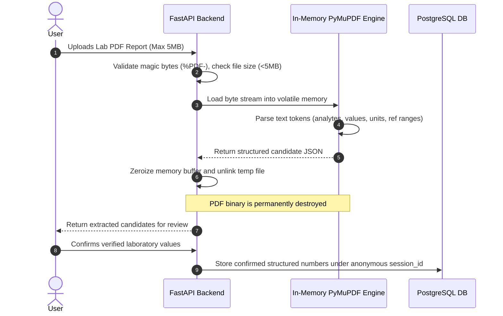

# Security, Privacy & Regulatory Compliance Review

- **Document Version**: 1.0.0
- **Document Date**: 2026-11-21
- **Status**: Completed Review
- **Regulatory Frameworks**: Indian Digital Personal Data Protection Act (DPDP 2023), US HIPAA Privacy Standards, EU GDPR (Art. 9), FDA Non-Device Clinical Decision Support (CDS) Guidance (2022).

---

## 1. Healthcare Data Classification & Threat Model

Healthcare information is inherently sensitive. Unauthorized disclosure, data corruption, or algorithm tampering introduces not only privacy violations but tangible risks to human life.

### 1.1 Data Classification Matrix

| Data Element | Sensitivity Level | Retention Policy | Storage & Encryption Standard |
| :--- | :--- | :--- | :--- |
| **Uploaded Lab PDF Binary** | **Critical Sensitive** | **Ephemeral (0 hours)**; deleted immediately upon text extraction confirmation. | Volatile memory / temp directory; unlinked post-extraction. **Never written to DB.** |
| **Extracted Lab Observations** | High Sensitive | Ephemeral Session (Max 24 hrs); user-triggered purge. | PostgreSQL, encrypted at rest (AES-256), linked only to anonymous session token. |
| **IDRS Parameters & Score** | High Sensitive | Ephemeral Session (Max 24 hrs); user-triggered purge. | PostgreSQL, encrypted at rest. No link to legal identity. |
| **Symptom Triage Questionnaire**| High Sensitive | Ephemeral Session (Max 24 hrs); user-triggered purge. | PostgreSQL, encrypted at rest. No link to legal identity. |
| **Medication Search Query** | Moderate | Anonymous query log (No PII). | Cached in memory / transient lookup table. |
| **Session Identifier** | Moderate (Security token) | 24-hour expiration (`expires_at`). | Cryptographically random UUIDv4 / SHA-256 token. |

---

## 2. Privacy-by-Design Implementation

### 2.1 The Ephemeral PDF Processing Lifecycle
To eliminate the risk of storing patient medical records, VYTAL enforces a strict ephemeral processing protocol:



### 2.2 Anonymity by Default & Zero PII Intake
- Users are never prompted for full legal names, national identification numbers (Aadhaar, Social Security), telephone numbers, or physical addresses.
- All session operations are indexed by an opaque, cryptographically random `session_token`.
- Users have a prominent **"Clear My Data"** button at every step, which executes a cascading SQL deletion of all observations, scores, triage runs, and summary briefs.

### 2.3 Zero Third-Party AI Data Transmission
- Patient-entered symptoms, laboratory numbers, and medication names are **never** transmitted to third-party commercial AI or LLM APIs (e.g., OpenAI, Anthropic, or cloud translation services) during live runtime.
- All clinical rules, scoring logic, and translations are executed locally within the self-contained VYTAL environment.

---

## 3. Application Security & Hardening Protocols

### 3.1 Defense-in-Depth Against Common Vulnerabilities (OWASP Top 10)
1. **Injection Vulnerabilities**:
   - Zero dynamic SQL string concatenation. All database operations execute through SQLAlchemy 2.0 parameterized queries.
   - Pydantic v2 enforces strict type validation and regex sanitization on all incoming payloads.
2. **Malicious File Upload Mitigation**:
   - Magic byte verification: Validates that the uploaded byte stream begins with `%PDF-` rather than trusting the client-supplied MIME header.
   - Size enforcement: Hardware/Nginx/FastAPI cuts off streams exceeding 5 MB with HTTP 413 Payload Too Large.
   - Script stripping: PyMuPDF parses text exclusively and ignores embedded PDF JavaScript, form submit actions, or executable payloads.
3. **Broken Object-Level Authorization (BOLA)**:
   - All resource lookups (`/reports/{id}`, `/summary/{id}`) require matching the client's `X-Session-Token` with the resource's owner `session_id`.
4. **Denial of Service (DoS) Mitigation**:
   - Rate limiting via token-bucket algorithm (default: 60 requests/minute per IP/session).

### 3.2 Security Headers & Transport Layer Security
In production, VYTAL enforces the following response headers:
```http
Strict-Transport-Security: max-age=63072000; includeSubDomains; preload
X-Content-Type-Options: nosniff
X-Frame-Options: DENY
X-XSS-Protection: 1; mode=block
Content-Security-Policy: default-src 'self'; script-src 'self'; style-src 'self' 'unsafe-inline'; img-src 'self' data:; connect-src 'self'; font-src 'self'; frame-ancestors 'none';
Referrer-Policy: strict-origin-when-cross-origin
```

---

## 4. Regulatory & Medical Device Non-Device Determination

### 4.1 US FDA Clinical Decision Support (CDS) Guidance (September 2022)
Under the 21st Century Cures Act and the FDA's final CDS guidance, software is **NOT** a regulated medical device if it meets all four statutory criteria:

| FDA Statutory Criterion | VYTAL Compliance Evidence | Compliance Determination |
| :--- | :--- | :---: |
| **Criterion 1**: Not intended to acquire, process, or analyze medical images or physiological signals. | VYTAL processes human-readable laboratory text reports and user questionnaires, not DICOM images, ECG waveforms, or continuous telemetry. | **PASSED** |
| **Criterion 2**: Intended for displaying, analyzing, or printing medical information. | VYTAL analyzes confirmed laboratory values, published risk scores, and documented medication interactions. | **PASSED** |
| **Criterion 3**: Intended for supporting or providing recommendations to healthcare professionals or patients. | VYTAL provides educational interpretations and preventive screening guidance, not diagnostic mandates. | **PASSED** |
| **Criterion 4**: Enables the user to independently review the basis for the recommendations. | VYTAL provides complete transparency: the exact formula, scoring breakdown, triggered clinical rules, and bibliographic literature sources are explicitly displayed. | **PASSED** |

### 4.2 EU Medical Device Regulation (EU MDR 2017/745)
- Under MDR Annex VIII, software intended for general health, well-being, and educational information that does not provide diagnostic or therapeutic decision-making is classified outside medical device scope.
- VYTAL adheres strictly to this boundary by explicitly excluding diagnostic determinations and prescription modifications.
