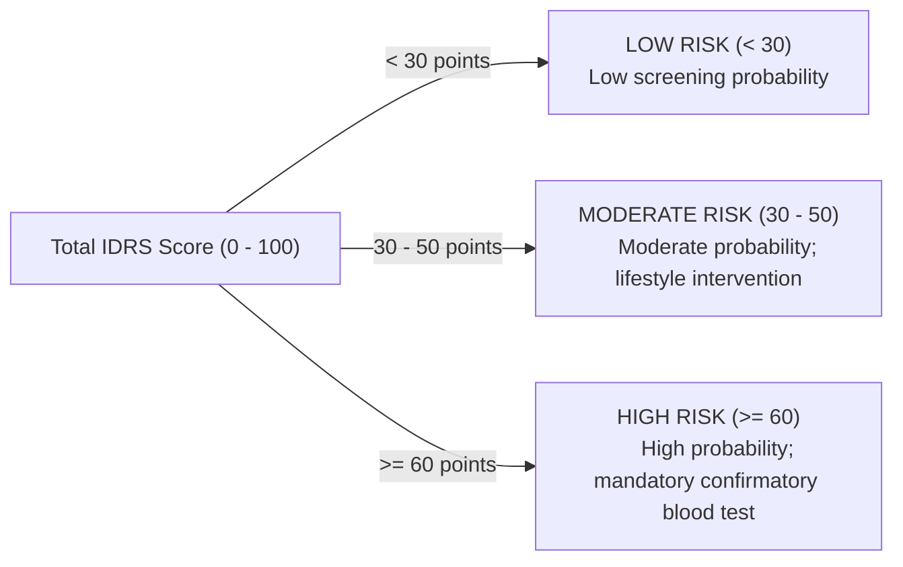

# Clinical Evidence Review: Indian Diabetes Risk Score (IDRS)

- **Document Version**: 1.0.0
- **Review Date**: 2026-11-21
- **Status**: Verified / Implementation Ready
- **Primary Focus**: Authoritative extraction and verification of the Indian Diabetes Risk Score methodology authored by Dr. V. Mohan and colleagues.

---

## 1. Bibliographic Metadata & Provenance

- **Title**: *A simplified Indian Diabetes Risk Score for screening for undiagnosed diabetic subjects*
- **Authors**: V. Mohan, R. Deepa, M. Deepa, S. Somannavar, M. Datta
- **Author Affiliations**: Madras Diabetes Research Foundation (MDRF) & Dr. Mohan's Diabetes Specialities Centre, Gopalapuram, Chennai, India.
- **Journal**: *Journal of the Association of Physicians of India* (JAPI)
- **Publication Date**: September 2005
- **Volume & Issue**: Volume 53, Pages 759–763
- **Indexed Identifiers**: PMID: 16334622
- **Study Parent Cohort**: Chennai Urban Rural Epidemiology Study (CURES) — specifically CURES Phase 1 ($N = 26,001$) and CURES Phase 3 ($N = 2,350$ representative cohort tested with oral glucose tolerance test).

---

## 2. Physiological & Epidemiological Rationale

The Indian Diabetes Risk Score was developed to address a critical public health failure: the widespread underdiagnosis of Type 2 Diabetes Mellitus (T2DM) in India, where over 50% of people with diabetes remain unaware of their condition until chronic complications develop.

Western risk assessment instruments (such as the American Diabetes Association Risk Score or the Finnish Diabetes Risk Score / FINDRISC) rely heavily on Body Mass Index (BMI). However, Asian Indians exhibit the **"Asian Indian Phenotype"** (or "thin-fat" phenotype):
- High body fat percentage and high visceral abdominal adiposity at relatively low BMI.
- Prominent insulin resistance and hyperinsulinemia at younger ages.
- Elevated cardiovascular risk at waist circumferences substantially lower than Caucasian thresholds.

Mohan and colleagues constructed a simplified, zero-cost, non-invasive risk engine utilizing multiple logistic regression on the CURES cohort, selecting four easily obtainable variables that optimized predictive power without requiring any laboratory infrastructure.

---

## 3. Parameter Scoring & Exact Point Verification

The IDRS produces a discrete integer score ranging from **0 to 100**.

| Risk Parameter | Specific Category / Threshold | Score Assigned | Evidence Verification & Clinical Justification |
| :--- | :--- | :---: | :--- |
| **1. Age** | $< 35\text{ years}$ | **0** | Baseline age category; incidence of T2DM is lowest below 35. |
| | $35 - 49\text{ years}$ | **20** | Reflects premature onset of T2DM in Indians (onset ~10 years earlier than Western cohorts). |
| | $\ge 50\text{ years}$ | **30** | Maximum age-related risk bracket reflecting progressive beta-cell dysfunction. |
| **2. Abdominal Obesity** *(Waist Circumference)* | **Female**: $< 80\text{ cm}$ **Male**: $< 90\text{ cm}$ | **0** | Normal waist circumference adhering to WHO/IDF Asian-specific criteria. |
| | **Female**: $80 - 89\text{ cm}$ **Male**: $90 - 99\text{ cm}$ | **10** | Moderate abdominal adiposity indicating visceral fat accumulation. |
| | **Female**: $\ge 90\text{ cm}$ **Male**: $\ge 100\text{ cm}$ | **20** | Severe central obesity, strongly correlated with insulin resistance and hepatic steatosis. |
| **3. Physical Activity** | Regular exercise **AND** strenuous manual/occupational work | **0** | High energy expenditure; protective against metabolic syndrome. |
| | Regular exercise **OR** strenuous manual/occupational work | **20** | Moderate activity level (either occupational labor without recreation, or brisk walking with sedentary desk job). |
| | **No exercise AND sedentary** occupational work | **30** | Severe physical inactivity; carries highest single behavioral penalty in the model. |
| **4. Family History** | Neither parent diagnosed with diabetes | **0** | No first-degree parental genetic predisposition. |
| | One parent diagnosed with diabetes | **10** | Uniparental family history (heterozygous risk profile). |
| | Both parents diagnosed with diabetes | **20** | Biparental family history (strong homozygous/polygenic predisposition). |

**Maximum Possible Score**: **100**

---

## 4. Risk Stratification & Performance Characteristics

In the original CURES validation cohort, receiver operating characteristic (ROC) curves determined that an IDRS value of **$\ge 60$** provided the optimal trade-off between sensitivity and specificity:

### Statistical Performance at Optimal Cut-Off ($\ge 60$):
- **Sensitivity**: **72.5%** (Identifies nearly three out of four individuals with undiagnosed diabetes).
- **Specificity**: **60.1%** (Correctly filters out 60% of non-diabetic individuals).
- **Positive Predictive Value (PPV)**: **17.0%** (Expected in general population screening).
- **Negative Predictive Value (NPV)**: **95.1%** (Provides high negative certainty in low-risk brackets).
- **Area Under the Curve (AUC)**: **0.698** ($95\%\text{ CI}: 0.663 - 0.733$).

---

## 5. Secondary Literature & Multi-Center Validation in India

Subsequent epidemiological studies have independently validated the IDRS across diverse Indian regions and demographic strata:
1. **ICMR-INDIAB Study (Indian Council of Medical Research - India Diabetes)**:
   - Evaluated IDRS performance across multiple states (Tamil Nadu, Jharkhand, Chandigarh, Maharashtra).
   - Confirmed that IDRS $\ge 60$ consistently captures over 70% of individuals with undiagnosed diabetes in both urban and rural environments.
2. **Eastern India & Odisha Cohort Studies**:
   - Tripathy et al. (2013) demonstrated that IDRS effectively stratified undiagnosed diabetes and metabolic syndrome in peri-urban Odisha communities.
3. **Cardiovascular & Metabolic Syndrome Correlation**:
   - Studies by Mohan et al. (2007) and Somannavar et al. (2008) showed that individuals with an IDRS $\ge 60$ also have an odds ratio of $2.5 - 3.0$ for coronary artery disease and metabolic syndrome, making IDRS an effective overall cardiometabolic screener.

---

## 6. Implementation Invariants & Safety Disclosures

For implementation in VYTAL Module 02:
1. **Zero Guessing of Boundaries**:
   - The code must implement exact boundaries: Age $<35$, $35-49$, $\ge 50$.
   - Waist: Male $<90$, $90-99$, $\ge 100$; Female $<80$, $80-89$, $\ge 90$.
   - Scores can only take valid sums ($0, 10, 20, 30, 40, 50, 60, 70, 80, 90, 100$).
2. **Prominent Non-Diagnostic Disclosure**:
   - The user must be informed: *"The Indian Diabetes Risk Score is an evidence-based risk-awareness and population screening tool. It does NOT diagnose diabetes. A high score ($\ge 60$) indicates that you should consult a doctor for a fasting plasma glucose or HbA1c blood test."*
3. **Multilingual Equivalents**:
   - Physical activity options and waist measurement guidelines must be translated with exact cultural nuances in Hindi and Odia (e.g., explaining sedentary occupational work clearly).

---

## 7. Verification Summary Matrix

- **Verified Facts**:
  - Exact four parameters: Age, Waist Circumference, Physical Activity, Family History.
  - Exact point tiers: $0, 10, 20, 30$. Total max: $100$.
  - Exact risk boundaries: $<30$ (Low), $30-50$ (Moderate), $\ge 60$ (High).
  - Primary source: Mohan et al., JAPI 2005; 53:759–763 (PMID: 16334622).
- **Assumptions**:
  - Adult population usage (validated for age $\ge 18$). Pediatric screening is excluded.
- **Proposed Decisions**:
  - Implement strictly as a backend Pydantic validator (`services/idrs/`).
  - Provide interactive waist circumference helper tool (converting inches to centimeters).
- **Unresolved Questions / Evidence Gaps**:
  - None regarding the core scoring algorithm. The 2005 published formula is unambiguous and universally validated.
- **Implementation Blockers**:
  - None. Ready for Phase 3 implementation.
