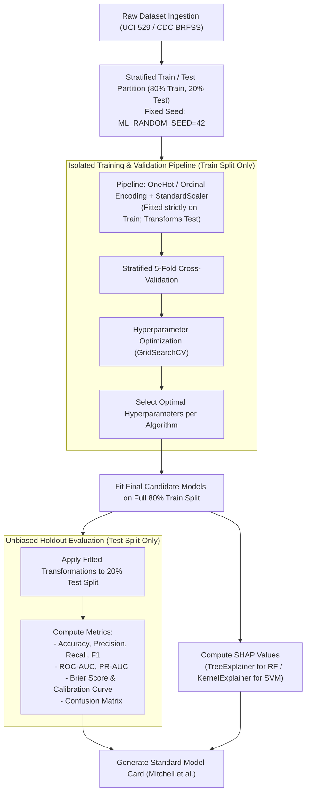

# Machine Learning Research Plan: Diabetes Risk Modeling & Explainable AI

- **Document Version**: 1.0.0
- **Document Date**: 2026-11-21
- **Status**: Finalized Research Plan
- **Primary Scientific Objective**: Rigorous, leakage-free investigation of machine learning algorithms for diabetes-risk classification using validated public cohorts, featuring SHAP explainability and comprehensive model cards.

---

## 1. Research Objectives & Foundational Principles

### 1.1 Core Objectives
1. **Model Exploration**: Benchmark four foundational algorithms—Logistic Regression, Decision Trees, Random Forests, and Support Vector Machines—on structured clinical and survey diabetes datasets.
2. **Explainability & Transparency**: Provide dual-level explainability (global feature importance and local instance-level explanations) via SHAP (SHapley Additive exPlanations) to demystify black-box predictions.
3. **Rigorous Leakage Prevention**: Enforce strict data hygiene, preventing data leakage across training, validation, and test splits.
4. **South Asian Epidemiological Grounding**: Explicitly address the historical misapplication of non-representative datasets (such as Pima Indians) to Asian Indian populations and prioritize South Asian clinical cohorts.

### 1.2 Healthcare Safety Position
- **Strict Decoupling**: The ML research pipeline is an independent scientific experiment. It lives under `/ml` and feeds an isolated "Research & Analytics Dashboard."
- **Zero Clinical Overrides**: ML predictions are **never** permitted to evaluate, inform, or override clinical triage rules, emergency red flags, or laboratory reference ranges.
- **Experimental Notice**: All model outputs must be explicitly labeled: *"Experimental Research Model — Not Clinically Validated — Not a Medical Diagnosis."*

---

## 2. Dataset Comparative Analysis & Provenance

| Evaluation Dimension | Primary Research Dataset: **UCI 529 (Sylhet)** | Secondary Benchmark: **UCI 891 (CDC BRFSS)** | Reference / Cautionary: **Pima Indians (PIDD)** |
| :--- | :--- | :--- | :--- |
| **Official Name** | Early Stage Diabetes Risk Prediction Dataset | CDC Diabetes Health Indicators | Pima Indians Diabetes Database |
| **Originating Institution** | Sylhet Diabetes Hospital, Sylhet, Bangladesh | Centers for Disease Control and Prevention (CDC) | National Institute of Diabetes & Digestive & Kidney Diseases |
| **Target Population** | **South Asian (Bangladeshi hospital outpatients)** | General United States adult population | **Pima Native American females (Arizona, USA)** |
| **Sample Size ($N$)** | **520 instances** (Clean, symptom-rich) | **253,680 survey respondents** | **768 instances** (Exclusively female $\ge 21$) |
| **Feature Dimensionality** | 16 features (Age, Gender, 14 clinical signs/symptoms) | 21 features (Demographics, lifestyle, comorbidities) | 8 physiological features (Pregnancies, Glucose, BP, Skin, Insulin, BMI, DPF, Age) |
| **Target Definition** | Binary: Risk of Diabetes (Positive / Negative) | Binary: `Diabetes_binary` (0 = No, 1 = Diabetes/Prediabetes) | Binary: `Outcome` (0 = Negative, 1 = Positive within 5 yrs) |
| **Missing Values** | None (Fully validated clinical questionnaires) | None (Cleaned survey responses) | Significant physiological zero-values (Insulin 48.7%, SkinFold 29.6% zero/missing) |
| **Class Distribution** | 320 Positive (61.5%), 200 Negative (38.5%) | 218,334 Negative (86.1%), 35,346 Positive (13.9%) | 500 Negative (65.1%), 268 Positive (34.9%) |
| **Licensing** | Creative Commons Attribution 4.0 (CC BY 4.0) | Public Domain (U.S. Federal Government) | Open Access (Smith et al., 1988) |
| **Key Limitation & Bias** | Hospital-based sample; potential referral bias | Self-reported survey data; lack of lab assays | **Demographically & genetically non-representative of Asian Indians; high missingness** |

### 2.1 Scientific Analysis of the Pima Indians Dataset (PIDD)
A persistent flaw in biomedical computer science literature is the uncritical assumption that the "Pima Indians Diabetes Database" represents the population of India.
- **Ethnographic Fact**: The Pima (Akimel O'odham) are an Indigenous Native American people indigenous to the Sonoran Desert in southern Arizona, USA.
- **Epidemiological Fact**: While the Pima community has exceptionally high rates of T2DM due to unique thrifty-gene evolutionary pressures and abrupt mid-20th-century dietary shifts, their genetic architecture, visceral adiposity distribution, and metabolic traits differ fundamentally from Asian Indians.
- **VYTAL Policy**: The Pima dataset is documented in research literature for historical continuity, but VYTAL's primary experimental models are trained on the **Sylhet South Asian clinical cohort (UCI 529)** and contextualized with large-scale population indicators (CDC BRFSS).

---

## 3. Machine Learning Algorithms & Methodological Rationale

### 3.1 Algorithm 1: Logistic Regression (L2 Regularized)
- **Role**: Interpretable linear baseline.
- **Rationale**: Generates odds ratios for each feature, enabling direct clinical comparison with classical epidemiological models.
- **Hyperparameter Grid**: Regularization strength $C \in [0.001, 0.01, 0.1, 1.0, 10.0, 100.0]$, penalty $=$ `l2`, solver $=$ `lbfgs`.

### 3.2 Algorithm 2: Decision Tree (CART)
- **Role**: Non-linear rule-extraction benchmark.
- **Rationale**: Produces human-readable decision rules and explicit splitting thresholds (e.g., Polyuria = 1 $\to$ Age > 45), aligning with clinical decision logic.
- **Hyperparameter Grid**: `max_depth` $\in [3, 4, 5, 6, 8, \text{None}]$, `min_samples_split` $\in [2, 5, 10]$, `criterion` $\in [\text{"gini"}, \text{"entropy"}]$.

### 3.3 Algorithm 3: Random Forest (Bagging Ensemble)
- **Role**: Robust non-linear performance standard.
- **Rationale**: Mitigates decision tree variance, models complex non-linear feature interactions, and yields stable out-of-bag feature importances.
- **Hyperparameter Grid**: `n_estimators` $\in [50, 100, 200]$, `max_depth` $\in [4, 6, 8, \text{None}]$, `min_samples_leaf` $\in [1, 2, 4]$, `max_features` $\in [\text{"sqrt"}, \text{"log2"}]$.

### 3.4 Algorithm 4: Support Vector Machine (SVM)
- **Role**: Kernel-based boundary classifier.
- **Rationale**: Tests whether high-dimensional geometric hyperplanes with Radial Basis Functions (RBF) achieve superior separation in symptom space.
- **Hyperparameter Grid**: $C \in [0.1, 1, 10, 100]$, $\gamma \in [\text{"scale"}, \text{"auto"}, 0.01, 0.1]$, kernel $\in [\text{"linear"}, \text{"rbf"}]$.

---

## 4. End-to-End Leakage-Proof Machine Learning Workflow

---

## 5. Comprehensive Model Evaluation & Validation Metrics

To ensure clinical and scientific validity, models are evaluated across multiple complementary axes:

1. **Classification Fidelity**:
   $$\text{Accuracy} = \frac{TP + TN}{TP + TN + FP + FN}, \quad \text{Balanced Accuracy} = \frac{1}{2}\left(\frac{TP}{P} + \frac{TN}{N}\right)$$
2. **Clinical Sensitivity (Recall) & Specificity**:
   $$\text{Recall / Sensitivity} = \frac{TP}{TP + FN}, \quad \text{Specificity} = \frac{TN}{TN + FP}$$
   *Clinical Priority*: In disease screening, high recall is prioritized to minimize false negatives (missed cases).
3. **Precision & F1-Score**:
   $$\text{Precision} = \frac{TP}{TP + FP}, \quad \text{F1-Score} = 2 \times \frac{\text{Precision} \times \text{Recall}}{\text{Precision} + \text{Recall}}$$
4. **Discrimination Curves**:
   - Receiver Operating Characteristic (ROC) area under curve (ROC-AUC).
   - Precision-Recall Curve (PR-AUC) — vital for imbalanced epidemiological cohorts (CDC BRFSS).
5. **Probability Calibration**:
   - **Brier Score**: $\frac{1}{N} \sum_{t=1}^N (f_t - o_t)^2$
   - Calibration plots (reliability diagrams) with isotonic/sigmoid calibration checks to guarantee that predicted probabilities reflect true empirical risk.

---

## 6. Model Explainability via SHAP

VYTAL incorporates SHAP (Lundberg & Lee, 2017) grounded in cooperative game theory (Shapley values):

$$\phi_i = \sum_{S \subseteq F \setminus \{i\}} \frac{|S|!(|F| - |S| - 1)!}{|F|!} \left[ f(S \cup \{i\}) - f(S) \right]$$

1. **Global Explainability**:
   - **Summary Beeswarm Plots**: Depicting feature impact directionality (e.g., how high values of Polyuria shift predictions toward positive risk).
   - **Mean Absolute SHAP Bar Charts**: Ranking features by global importance across the entire cohort.
2. **Local Instance-Level Explainability**:
   - **Waterfall Plots**: Breaking down individual predictions from the baseline expected value $E[f(x)]$ to the final output $f(x)$, explicitly displaying which specific symptoms pushed the score higher or lower.
3. **Clinical Interpretation Guardrails**:
   - The UI clarifies: *"SHAP values quantify statistical feature contribution within this mathematical model; they do not represent clinical causality."*

---

## 7. Model Governance: Model Card Specification

Following the framework of Mitchell et al. (*Model Cards for Model Reporting*, 2019), every trained model artifact is accompanied by a standardized markdown document:
- **Model Details**: Architecture, version, author, date, license.
- **Intended Use**: Academic demonstration, risk factor sensitivity analysis, student education.
- **Out-of-Scope Use**: Clinical diagnosis, emergency triage, prescription decision-support, standalone patient management.
- **Factors & Subpopulations**: Performance broken down by gender and age categories to detect demographic performance disparities.
- **Metrics**: 5-Fold CV metrics and test set metrics.
- **Ethical Considerations & Limitations**: Discussion of dataset size, geographic origin (Sylhet, Bangladesh), and need for external multi-site clinical validation.
