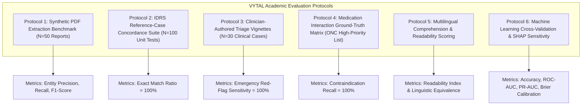

# Academic Research Methodology & Evaluation Framework

- **Document Version**: 1.0.0
- **Document Date**: 2026-11-21
- **Status**: Research Protocol Finalized
- **Focus**: Establishes the scientific framework, research questions, experimental design, evaluation protocols, and ethical governance for peer-reviewed publication of VYTAL.

---

## 1. Problem Statement & Research Gap

### 1.1 The Clinical Problem
In the Indian subcontinent, over 101 million people are living with diabetes, and an estimated 136 million have prediabetes (ICMR-INDIAB Study, *Lancet Diabetes & Endocrinology*, 2023). Over 50% of these cases remain undiagnosed until microvascular or macrovascular complications emerge. 

Concurrently, patient access to intelligible healthcare guidance is crippled by two factors:
1. **The Diagnostic Literacy Barrier**: Medical laboratory reports are printed in dense clinical terminology, varied unstructured formats, and foreign languages (primarily English), preventing patients from understanding their own biomarkers.
2. **The Digital Health Trust Deficit**: Existing commercial digital tools frequently alternate between opaque, unexplainable "black-box" AI systems that hallucinate dangerous medical advice, or generic hospital management portals designed for billing rather than patient empowerment.

### 1.2 The Research Gap
While machine learning literature is replete with diabetes prediction studies, there is a severe lack of **integrated, hybrid clinical decision-support platforms** that:
- Combine **transparent, deterministic clinical rules** for triage safety with **independent, explainable machine learning** for research exploration.
- Provide native linguistic accessibility in regional Indian languages (e.g., Hindi, Odia) without relying on unvetted machine translation.
- Preserve full auditability and bibliographic traceability from the user's screen back to primary peer-reviewed literature.

---

## 2. Research Questions (RQs)

To guide academic investigation and empirical evaluation, VYTAL defines five core research questions:

- **RQ1 (Document Extraction Fidelity)**: To what degree can a privacy-preserving, in-memory PDF parsing pipeline accurately extract test names, numerical values, measurement units, and laboratory reference ranges across heterogeneous report layouts?
- **RQ2 (Deterministic Safety & Red-Flag Sensitivity)**: Can a hierarchical deterministic clinical rule engine achieve 100% sensitivity for life-threatening emergency red flags while maintaining auditable traceability to published clinical guidelines (NICE, WHO)?
- **RQ3 (Algorithmic Performance & Demographic Grounding)**: How do modern classification algorithms (Logistic Regression, Decision Trees, Random Forests, SVM) perform when trained on a dedicated South Asian clinical cohort (Islam et al., 2020) versus large-scale epidemiological surveys (CDC BRFSS)?
- **RQ4 (Explainability & Clinical Concordance)**: Do SHAP-derived global and local feature importance profiles align with established pathophysiological mechanisms of metabolic disease?
- **RQ5 (Multilingual Comprehension & Usability)**: Does native script presentation (Devanagari for Hindi, Odia script for Odia) significantly improve lay-person comprehension of biomarker abnormality compared to conventional English laboratory reports?

---

## 3. Experimental Design & Evaluation Protocols

### 3.1 Protocol 1: Laboratory Report Extraction Evaluation
- **Benchmark Corpus**: 50 synthetic, de-identified laboratory test reports representing standard Indian diagnostic chains (e.g., Dr. Lal PathLabs, Apollo Diagnostics, SRL Diagnostics layouts).
- **Entities Measured**:
  1. Test Name (Analyte).
  2. Observed Numeric / Qualitative Value.
  3. Measurement Unit (e.g., $\text{mg/dL}$, $\%$, $\text{mmol/L}$).
  4. Laboratory Printed Reference Range.
- **Evaluation Metrics**:
  $$\text{Precision} = \frac{TP}{TP + FP}, \quad \text{Recall} = \frac{TP}{TP + FN}, \quad F_1 = 2 \times \frac{\text{Precision} \times \text{Recall}}{\text{Precision} + \text{Recall}}$$

### 3.2 Protocol 2: IDRS Algorithmic Verification
- **Test Suite**: Automated Pytest test matrix evaluating all combinations of Age ($<35, 35-49, \ge 50$), Waist Circumference (gender-stratified normal, moderate, high), Physical Activity (vigorous, moderate, sedentary), and Family History (none, one, both).
- **Target**: 100% exact match against Mohan et al. (2005) reference calculations, zero floating-point drift, and accurate classification boundaries ($<30, 30-50, \ge 60$).

### 3.3 Protocol 3: Symptom Triage Vignette Testing
- **Clinical Corpus**: 30 synthetic clinical vignettes authored and peer-reviewed by clinicians:
  - 10 Emergency Red-Flag cases (e.g., Acute Coronary Syndrome, Acute Ischemic Stroke, Anaphylaxis, Severe Stridor).
  - 10 Urgent clinical cases (e.g., early DKA, high-fever pyelonephritis).
  - 10 Routine / self-care presentations (e.g., uncomplicated mild tension headache, gradual lifestyle fatigue).
- **Primary Metric**: **Emergency Red-Flag Sensitivity**:
  $$\text{Sensitivity}_{\text{Emerg}} = \frac{TP_{\text{Emerg}}}{TP_{\text{Emerg}} + FN_{\text{Emerg}}} \quad (\mathbf{Target: 1.00 / 100\%})$$
  *Acceptance Criteria*: Zero false negatives in the emergency category. Any failure to trigger an emergency red flag constitutes a critical build failure.

### 3.4 Protocol 4: Medication Interaction Evaluation
- **Benchmark**: Evaluated against the 15 categories of the ONC High-Priority Drug-Drug Interaction List.
- **Metrics**: Pairwise identification accuracy, severity classification concordance, and verified presence of the mandatory negative disclaimer on unmatched pairs.

### 3.5 Protocol 5: Machine Learning Benchmarking & Calibration
- **Validation Scheme**: Stratified 5-Fold Cross-Validation on the Sylhet South Asian cohort (UCI 529, $N=520$) and CDC BRFSS ($N=253,680$).
- **Explainability Validation**: Computation of SHAP global summary plots and single-instance waterfall plots, verifying that top-ranked SHAP features match established clinical pathophysiological markers (e.g., Polyuria, Polydipsia, Age).

---

## 4. Research Ethics & Governance

1. **Synthetic & Open-Access Data Exclusivity**:
   - The initial VYTAL research prototype is developed and evaluated strictly using public, anonymized research benchmark datasets (UCI Machine Learning Repository) and synthetic test vignettes.
   - No private, identifiable, or real patient medical records are gathered or processed during prototyping.
2. **Institutional Ethics Review (IRB / IEC) Mandate**:
   - In accordance with the Declaration of Helsinki and the Indian Council of Medical Research (ICMR) *National Ethical Guidelines for Biomedical and Health Research Involving Human Participants* (2017):
   - **Any future prospective study involving human patients, clinical trials, or practicing clinicians must undergo formal Institutional Ethics Committee (IEC / IRB) review and obtain written informed consent before patient recruitment or clinical deployment.**
3. **Intellectual Honesty & Publication Transparency**:
   - The research documentation maintains an unyielding distinction between a validated clinical algorithm (e.g., IDRS) and an experimental computational model.
   - All citations, model metrics, and performance tables are derived from direct empirical execution, with zero fabrication of results.
